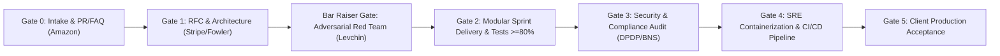

# VERITAS OSINT — SDC Operational Charter
### Enterprise Standard v3.0 | Software Development Company Framework
**Benchmarked Against:** Google (SRE/Monorepo), Stripe (API/Design), Amazon (Working Backwards), Netflix (Chaos/Observability), PayPal (Levchin Rigor), Palantir (Forward-Deployed OSINT)

---

## 1. Executive Governance
- **Executive Product Owner (Client):** Holds sole gate approval rights, sets strategic priorities, and authorizes production deployment.
- **Rule #1 (Zero Automatic Changes):** Every architectural mutation, schema adjustment, and milestone transition is formally submitted for Client sign-off.
- **Operating Model:** Hybrid-Agile (Scrumban). Upfront RFC contracts (Gate 0 & Gate 1) followed by high-velocity test-driven delivery (Gates 2 through 5).

---

## 2. Eight Cross-Functional Disciplines

| Discipline | Persona | Benchmark Standard | Key Deliverable |
| :--- | :--- | :--- | :--- |
| **Product Manager** | `product_manager` | Amazon *Working Backwards* | Customer PR/FAQ, user stories, acceptance criteria |
| **CTO / Architect** | `cto` | Distributed Systems Arch | 1-Page RFC, schema contracts, clean room isolation |
| **Bar Raiser / Red Team** | `bar_raiser` | PayPal / Levchin Rigor | Adversarial failure-mode analysis, falsification checks |
| **Lead Engineer** | `lead_engineer` | Google Staff Eng | Clean modular architecture, trunk-based delivery |
| **UI/UX Designer** | `ui_ux_designer` | Stripe & Apple Design | Design tokens, WCAG 2.2 AA accessibility, HUD UI |
| **QA / SDET Lead** | `qa_engineer` | Google Test Engineering | Automated test suite ($\ge 80\%$ coverage), regression CI |
| **DevOps & SRE** | `devops_sre` | Google SRE & Netflix Chaos | Dockerfile, docker-compose, CI/CD, telemetry health |
| **Security Engineer** | `security_engineer` | Zero-Trust & OWASP | DPDP Act 2023 PII scrubbing, IT Act Sec 79 Safe Harbour |

---

## 3. Milestone Gates & Verification Path

