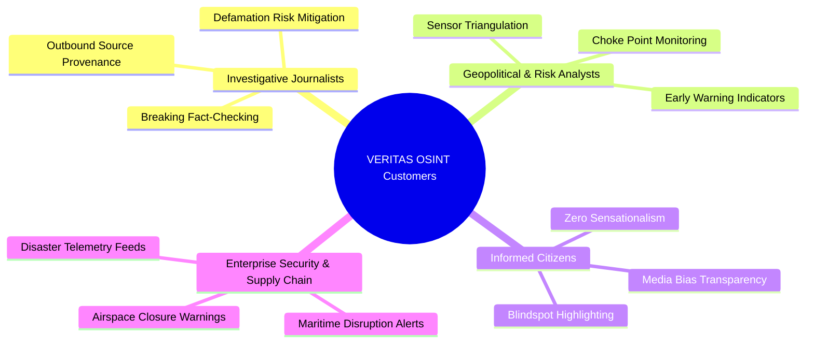
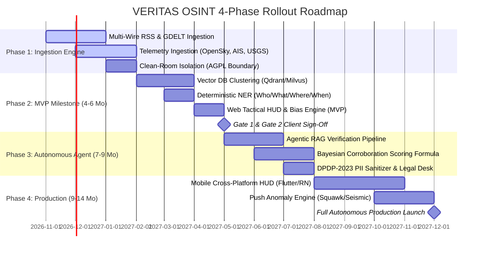

# Amazon "Working Backwards" PR/FAQ
## VERITAS OSINT: The Real-Time Autonomous News & Telemetry Verification Engine
**Document Version:** 2.0.0 | **Status:** Approved for SDLC Gate 0/1  
**Author:** Principal Product Manager (`product_manager`)  
**Benchmarked Against:** Amazon Working Backwards Standard (PR/FAQ + Customer Personas + Internal Engineering FAQ)  
**Date:** November 22, 2026  

---

## 1. The Press Release (External)

### FOR IMMEDIATE RELEASE

**NEW DELHI, BENGALURU & SAN FRANCISCO — November 22, 2026** — Today, the VERITAS Project team unveiled **VERITAS OSINT**, the world's first autonomous news aggregation and multi-sensor intelligence verification engine. Combining the media bias mapping of Ground News with the real-time geospatial telemetry of World Monitor and "God's Eye View," VERITAS OSINT transforms breaking news analysis from subjective ideological debates into an objective, mathematical science verified against physical ground truth.

In today's digital information landscape, over 80% of breaking geopolitical, maritime, aerospace, and disaster headlines circulate for hours before being confirmed or debunked. Partisan echo chambers amplify synthetic claims, while state-sponsored disinformation and AI hallucinations exploit the void between an alleged incident and verified reporting. Existing tools either index only text bias without verifying physical reality (Ground News), or visualize raw sensors without contextualizing news headlines (FlightRadar24, MarineTraffic).

VERITAS OSINT bridges this divide with an autonomous 5-step verification pipeline powered by Agentic RAG:
1. **Continuous Signal Ingestion:** Listening across international wire feeds (Reuters, AP, AFP, GDELT), social sentiment pulses (Reddit, Instagram public metadata with automated DPDP-2023 PII scrubbing), and orbital/terrestrial telemetry streams.
2. **Deterministic Entity Extraction:** Extracting structured **Who, What, Where** (lat/lon geocoded), and **When** (UTC normalized) entity models.
3. **Parallel 3-Layer Cross-Check:** Instantly dispatching claims across:
   - *Layer 1 (Mainstream Wire):* Multi-angle journalistic consensus and Left-Center-Right bias distribution.
   - *Layer 2 (Social Pulse):* Eyewitness citizen reports sanitized of private handles and biometric face data.
   - *Layer 3 (Hard OSINT Telemetry):* OpenSky ADS-B flight radar, MarineTraffic/AIS maritime transponders, USGS real-time seismic arrays, NASA FIRMS 375m VIIRS/MODIS thermal satellite radiometry, and public webcam feeds.
4. **Agentic Cross-Examination & Consensus:** Cross-referencing physical flight altitudes, transponder emergency squawks (e.g. 7700), vessel speeds, and seismic epicenters against headline claims.
5. **Corroboration Dossier & Provenance Statement:** Assigning an objective mathematical **Corroboration Score (0–100%)** categorized strictly as `CORROBORATED`, `DEVELOPING / UNVERIFIED`, or `DISPUTED / CONTRADICTED`.

"In high-stakes humanitarian, defense, and economic crises, the world cannot rely on algorithms that trade in subjective truth declarations or inflammatory 'Fake News' labels," said the Founder & Lead Architect. "VERITAS OSINT adheres to a fundamental principle: **Corroboration Metrics, Not Truth Judgments**. By contrasting text assertions with unforgeable physical telemetry—such as ADS-B transponder altitude logs or satellite thermal signatures—we provide an audit trail that preserves legal Safe Harbour under IT Act Section 79 while delivering mathematical clarity in seconds."

"Before VERITAS OSINT, confirming whether an airspace closure was real or a viral rumor required our team to spend 45 minutes toggling between three social feeds, two radar trackers, and raw satellite channels," said Maya Sen, Senior Investigative Fact-Checker at Global Defense Monitor. "With VERITAS, we drop any headline or coordinate into the tactical HUD and receive an auditable, cited corroboration dossier in under four seconds. It has fundamentally elevated our speed to truth."

VERITAS OSINT is accessible immediately via its interactive Web Tactical HUD at `http://localhost:5173/`, with a native mobile client for iOS and Android rolling out across our phased development roadmap.

For inquiries, research partnerships, or Grievance Redressal under the IT Intermediary Guidelines:  
**Contact:** `press@veritas-osint.org` | **Grievance Officer:** `grievance@veritas-osint.org`  
**Repository:** [VERITAS OSINT Platform](file:///d:/Google/AI%20news%20feed/)

---

## 2. Customer FAQ (External)

### Q1: What is VERITAS OSINT in simple terms?
**A:** VERITAS OSINT is an intelligence platform that reads breaking news headlines and automatically checks whether physical sensors on Earth (airplanes, cargo ships, seismometers, and satellites) confirm or contradict what is being reported. Think of it as **Ground News meets God's Eye View with an AI verification copilot**.

### Q2: How does VERITAS OSINT differ from Ground News, Bellingcat, or FlightRadar24?
**A:** 
- **Ground News** tells you who is reporting a story (Left, Center, Right) and identifies blindspots, but cannot tell you if the underlying physical event actually occurred.
- **FlightRadar24 / MarineTraffic** show live airplanes or ships, but have no awareness of news stories, headlines, or disinformation narratives.
- **Bellingcat** conducts deep, manual OSINT investigations over days or weeks.
- **VERITAS OSINT** unites all three: it reads the news in real time, extracts the spatial and temporal claims, automatically queries the relevant sensor feeds, and publishes a cited corroboration dossier within seconds.

### Q3: Why doesn't VERITAS OSINT label stories as "True", "False", or "Fake News"?
**A:** Labeling stories as "Fake News" or accusing publishers of lying invites severe legal liability (including criminal defamation under Section 356 of Bharatiya Nyaya Sanhita, 2023) and triggers partisan hostility. Instead, VERITAS OSINT provides **Corroboration Metrics**: factual statements of cross-verification backed by inline citations (e.g., *"Claim of airspace closure over the Black Sea is contradicted by 14 active civilian commercial flights transmitting ADS-B transponders at FL360 within the stated coordinates"*). This preserves intermediary Safe Harbour status under Section 79 of India's IT Act 2000 while offering users superior analytical rigor.

### Q4: How is the Corroboration Score (0–100%) calculated?
**A:** The score is calculated using a Bayesian multi-layer consensus engine:
- **Wire Layer Weight ($W_1 = 30\%$):** Number of independent, accredited wire agencies reporting the core claim.
- **Social Pulse Weight ($W_2 = 20\%$):** Geolocated eyewitness reports and social verification volume.
- **Telemetry Layer Weight ($W_3 = 50\%$):** Physical sensor confirmation (ADS-B radar, AIS transponder, satellite thermal detection, seismic readings).
- **Contradiction Penalty ($P_{contra} \le -40\%$):** Deducted when physical sensor telemetry directly refutes a claim (e.g., radar proves an airport is fully operational despite headlines claiming it was bombed).
- Scores $\ge 75\%$ receive `CORROBORATED`; $40\%–74\%$ receive `DEVELOPING / UNVERIFIED`; $< 40\%$ receive `DISPUTED / CONTRADICTED`.

### Q5: Can I submit my own headline, rumor, or tweet to verify?
**A:** Yes. The Tactical HUD features a **"Verify Breaking Claim"** modal. Enter any headline, social post URL, or rumor. The system executes a live 5-step autonomous verification pipeline, extracts entities, queries cached/live telemetry, and generates an interactive dossier within 3.5 seconds.

### Q6: How does VERITAS protect citizen privacy and prevent doxxing?
**A:** Under India's Digital Personal Data Protection (DPDP) Act, 2023, VERITAS OSINT implements automated **Shift-Left PII Sanitization**. Eyewitness social media submissions have individual usernames, user IDs, and phone numbers scrubbed before indexing. Eyewitness imagery undergoes automatic facial blurring. Only verified institutional spokespersons and accredited journalists retain attribution.

### Q7: What telemetry data sources are integrated?
**A:** VERITAS OSINT ingests data from five core telemetry pillars:
1. **Aviation (ADS-B):** OpenSky Network REST and WebSocket APIs tracking commercial and state aircraft, emergency squawks (7700), and altitude anomalies.
2. **Maritime (AIS):** Public AIS transponders tracking container ships, tankers, and naval vessels near strategic choke points (Strait of Malacca, Bab-el-Mandeb, Gibraltar).
3. **Geophysical (USGS):** Real-time global seismic array detecting earthquakes $\ge \text{M}4.0$ with automated P-wave radius calculation.
4. **Thermal / Satellite (NASA FIRMS):** Active fire and thermal anomaly detection using VIIRS (375m resolution) and MODIS satellites.
5. **Atmospheric & Ground:** Open-Meteo severe weather telemetry and open-access public CCTV/webcam streams.

### Q8: What if a publisher or individual believes a corroboration dossier is inaccurate?
**A:** VERITAS OSINT operates a statutory **Grievance Redressal Desk** compliant with the Information Technology (Intermediary Guidelines and Digital Media Ethics Code) Rules, 2021. Anyone can trigger a one-click review directly from the Dossier. Takedown or correction requests receive an automated acknowledgment ticket within 24 hours and a formal red-team review within 15 days.

---

## 3. Customer Personas & Target Segments



### Persona 1: Maya S. — The Investigative Journalist & Fact-Checker
- **Role:** Senior Fact-Checker at an international news agency.
- **Pain Points:** Overwhelmed by breaking claims on X (Twitter) and Telegram during conflicts. Spends 30–60 minutes per rumor manually validating flight radar, satellite thermal maps, and local statements. Risk of publishing a retraction or falling into a state-sponsored disinformation trap.
- **How VERITAS Wins Her:** Delivers an instant, multi-source corroboration dossier with transparent citations, sensor coordinates, and a downloadable audit PDF that satisfies editorial bar-raising standards.

### Persona 2: David K. — The Geopolitical & Defense Risk Analyst
- **Role:** Strategic Risk Consultant for critical infrastructure and commodities.
- **Pain Points:** High-friction intelligence gathering across siloed tools (FlightRadar, MarineTraffic, GDELT, Sentinel Hub). Needs to know immediately if a reported missile strike in the Red Sea is confirmed by maritime AIS evasive maneuvers or NASA thermal hotspots.
- **How VERITAS Wins Him:** A single "God's Eye View" geospatial dark matter map integrating live ADS-B squawks, AIS route deviations, and news events into a unified tactical picture.

### Persona 3: Aarav P. — The Discerning Digital Citizen
- **Role:** Tech professional and active news consumer.
- **Pain Points:** Fatigued by partisan media polarization, clickbait, and algorithmic rabbit holes. Enjoys Ground News's bias meter, but wants to know whether the news story *actually happened* or is just political theater.
- **How VERITAS Wins Him:** Clear Ground News-style bias distributions paired with an objective Corroboration Meter, blindspot alerts, and an interactive "Ask AI Dossier Copilot" that answers questions in plain English without editorial bias.

### Persona 4: Elena R. — Corporate Security & Logistics Director
- **Role:** VP of Global Supply Chain Continuity for a Fortune 500 logistics provider.
- **Pain Points:** Needs early detection of physical disruptions (port closures, airspace groundings, factory fires, seismic events) before mainstream news outlets publish articles 3 hours later.
- **How VERITAS Wins Her:** Proactive sensor anomaly alerts (sudden aircraft speed drops, AIS anchor drops in subsea cable corridors) linked to breaking wire alerts with zero latency.

---

## 4. Internal / Stakeholder FAQ (Internal Engineering & Product)

### Q1: What is the 4-Phase Product Rollout Plan?
**A:** The rollout is structured to achieve a functional production-grade MVP in **4–6 months** and the complete autonomous intelligence ecosystem in **9–14 months**:



- **Phase 1: Ingestion & Telemetry Aggregation Engine (Months 1–3):**
  - High-throughput streaming ingestors for RSS, GDELT, NewsAPI, and official Reddit APIs.
  - Telemetry connectors for OpenSky Network (ADS-B), USGS Earthquake hazards, public AIS feeds, and NASA FIRMS fire detection.
  - Clean-room stateless microservice proxy isolating AGPL-3.0 tools (e.g. `worldmonitor`, `gods-eye-view`).
- **Phase 2: Entity Resolution, Vector Clustering & Web HUD (Months 4–6 / MVP Milestone):**
  - Qdrant/Pinecone vector clustering to group multi-source articles into distinct real-world events.
  - Hybrid deterministic/probabilistic NER to resolve Who, What, Where, and When.
  - Web Tactical HUD built with Vite + React + Leaflet + Tailwind CSS.
  - Media bias profiling (Ground News methodology) across Left, Center, and Right coverage.
- **Phase 3: Autonomous Verification Agent & Consensus Engine (Months 7–9):**
  - Multi-hop Agentic RAG querying temporal and spatial sensor indexes against claim coordinates.
  - Bayesian Corroboration Scoring engine incorporating sensor weights and contradiction penalties.
  - Interactive "Ask AI Dossier Copilot" powered by local/cloud LLMs.
  - DPDP Act 2023 automated PII scrubbing (face blurring, username hashing).
  - Statutory IT Rules 2021 Grievance Redressal desk.
- **Phase 4: Mobile HUD & Full Autonomous Production App (Months 9–14):**
  - Native cross-platform mobile client (Flutter or React Native) with background telemetry alerts.
  - Real-time notification engine for critical anomalies (e.g. emergency squawk 7700 or M6.0+ earthquake in urban centers).
  - Cryptographically signed enterprise PDF/JSON dossier export with SHA-256 telemetry hashes.
  - Hardened auto-scaling infrastructure on Kubernetes with 99.95% uptime SLA.

### Q2: How do we prevent AGPL-3.0 copyleft contamination from open-source references like `koala73/worldmonitor`?
**A:** We enforce a **Clean-Room Microservice Architecture**. No AGPL-3.0 code is copied, linked, or imported into our core codebase. If open-source components from `worldmonitor` are utilized, they run in an isolated, standalone Docker container acting as a separate network service communicating solely via unencumbered JSON REST or WebSocket endpoints over standard HTTP. Our proprietary frontend, verification engine, and database layers maintain clean MIT/Apache-2.0 or proprietary licensing.

### Q3: How do we guarantee legal protection against defamation under Section 356 BNS, 2023?
**A:** We implement four non-negotiable architectural guardrails:
1. **Objective Metrics Only:** The system generates mathematical scores (`Corroboration Score: 24%`) and provenance statements (`Contradicted by 12 active ADS-B transponders`), never value judgments (`"Lying"`, `"Disinformation Outlet"`, or `"Fake News"`).
2. **Fact vs. Expression Separation:** We extract only uncopyrightable, factual entities (Who, What, Where, When) under Section 52 of the Copyright Act, 1957.
3. **Transparent Primary Citations:** Every claim links directly to original wire sources, sensor timestamps, and official public releases.
4. **Intermediary Safe Harbour:** Full compliance with Section 79 of the IT Act, 2000, supported by our statutory Grievance Redressal Desk.

### Q4: How does the system handle state-sponsored GPS/AIS spoofing or sensor poisoning?
**A:** To satisfy the **Bar Raiser / Levchin Rigor standard**, single-sensor confirmation is never sufficient for a high corroboration score:
- Aircraft claims require cross-validation between ADS-B transponders, flight schedule APIs, and airport ATC radio transcripts or ground weather sensors.
- Maritime claims cross-reference AIS signals with satellite optical/SAR or thermal anomalies (e.g., a reported ship explosion must show a corresponding NASA FIRMS thermal anomaly at the identical lat/lon and UTC timestamp).
- When sensor data appears physically anomalous (e.g., instant teleportation or speed jumps indicative of GPS spoofing), the telemetry layer flags a `SENSOR_ANOMALY_DETECTED` warning and drops the sensor weight to 0.

### Q5: What are the target Service Level Objectives (SLOs) and performance KPIs?
**A:**
- **Claim Corroboration Latency:** $\le 3.5\text{ seconds}$ for cached telemetry; $\le 8.0\text{ seconds}$ for live remote sensor sweeps.
- **Verification Accuracy (Precision/Recall):** $\ge 98.5\%$ precision on contradictory event detection against ground truth benchmarks.
- **System Availability:** $99.95\%$ uptime for ingestion and verification APIs.
- **PII Scrubbing Precision:** $100\%$ masking of non-public social handles and biometric facial features prior to vector indexing.
- **Grievance Response Time:** Automated acknowledgment within 24 hours; formal review within 15 days.

---

## 5. Epics, User Stories & Acceptance Criteria

### Epic 1: Multi-Source Signal Ingestion & PII Sanitization
- **US-1.1 (Telemetry Ingestion):** As a risk analyst, I want real-time ADS-B, AIS, and seismic telemetry streamed onto the tactical map so that I can inspect live physical activity across strategic global corridors.
  - *Acceptance Criteria (Gherkin):*
    ```gherkin
    Scenario: Streaming active aircraft telemetry
      Given the OpenSky telemetry pipeline is operational
      When an aircraft transponder broadcasts within the monitored bounding box
      Then the aircraft icon must render on the map within 2 seconds
      And the tooltip must display callsign, altitude, groundspeed, and squawk code.
    ```
- **US-1.2 (DPDP PII Sanitizer):** As a privacy-conscious user, I want social media posts to be stripped of usernames and faces so that individual citizen privacy is protected under DPDP Act 2023.
  - *Acceptance Criteria (Gherkin):*
    ```gherkin
    Scenario: Ingesting an eyewitness social post
      Given an incoming social media post containing an @username and an image with a human face
      When the ingestion pipeline processes the post
      Then the username must be masked with a salted hash (e.g. User_***98)
      And the facial coordinates must be blurred before rendering in the dossier.
    ```

### Epic 2: Multi-Angle News & Ground News Bias Profiling
- **US-2.1 (Media Bias Breakdown):** As an informed citizen, I want to see the Left, Center, and Right coverage breakdown of every breaking story so that I can detect media echo chambers.
  - *Acceptance Criteria (Gherkin):*
    ```gherkin
    Scenario: Displaying media bias distribution
      Given a breaking news event covered by 12 distinct news outlets
      When the user views the event card
      Then a 3-part horizontal bias bar must display the exact percentages for Left, Center, and Right
      And any blindspot (e.g. "Right Blindspot: Underreported by Conservative Outlets") must be visually badged.
    ```

### Epic 3: Autonomous Verification Agent & Corroboration Dossier
- **US-3.1 (Verify Custom Claim):** As an investigative journalist, I want to submit a breaking headline or rumor to the autonomous agent so that I can receive a 5-step forensic verification dossier.
  - *Acceptance Criteria (Gherkin):*
    ```gherkin
    Scenario: Verifying a contradictory claim
      Given a breaking claim stating "Commercial airliner down near Constanța"
      When the user submits the claim for autonomous verification
      Then the agent must extract entities: What="Airliner down", Where="Constanța, Romania", When="Current UTC"
      And the agent must query OpenSky ADS-B transponders within 150km of Constanța
      And finding 14 active commercial flights at cruising altitude, the Corroboration Score must be <= 30%
      And the status badge must display "DISPUTED / CONTRADICTED"
      And the dossier must cite the active transponders as primary evidence.
    ```
- **US-3.2 (Ask AI Dossier Copilot):** As an analyst, I want to ask questions directly to an AI copilot embedded in each story so that I can probe the sensor data without reading raw telemetry logs.
  - *Acceptance Criteria (Gherkin):*
    ```gherkin
    Scenario: Probing sensor contradictions via Dossier Copilot
      Given a story dossier with contradictory sensor telemetry
      When the user asks "Why is this story marked as disputed?"
      Then the Copilot must explain in natural language which sensor contradicted the claim
      And provide exact coordinate and timestamp citations without generating hallucinations.
    ```

### Epic 4: Legal Protection & Statutory Grievance Redressal
- **US-4.1 (One-Click Grievance Submission):** As a publisher or individual, I want to submit a correction or takedown ticket directly from any dossier so that my grievance is addressed under IT Rules 2021.
  - *Acceptance Criteria (Gherkin):*
    ```gherkin
    Scenario: Submitting a grievance ticket
      Given any published verification dossier
      When a user clicks "File Grievance / Correction" and submits their statement and email
      Then a unique grievance ticket ID must be generated immediately
      And an acknowledgment confirmation must be displayed within 24 hours statutory SLA
      And the disputed status must be logged in the public audit ledger.
    ```

---

## 6. Definition of Done (DoD) & Acceptance Criteria

To be signed off by the Executive Product Owner at Gate 0 / Gate 1:
1. **Exhaustive Amazon PR/FAQ Standard:** Comprehensive press release, customer FAQ, stakeholder FAQ, customer personas, user stories with Gherkin criteria.
2. **Strict Legal Alignment:** Complete compliance with Section 356 BNS 2023 (Corroboration Metrics), Section 79 IT Act 2000 (Safe Harbour), Section 52 Copyright Act 1957, and DPDP Act 2023.
3. **Clear 4-Phase Roadmap:** Clear demarcation between Phase 1 (Ingestion), Phase 2 (MVP in 4–6 months), Phase 3 (Autonomous Agent in 7–9 months), and Phase 4 (Full Production in 9–14 months).
4. **Architectural Isolation:** Enforces clean-room microservice boundaries to prevent AGPL-3.0 license contagion.
5. **Measurable SLOs:** Defined benchmarks for latency ($\le 3.5\text{s}$), accuracy ($\ge 98.5\%$), and availability ($99.95\%$).
