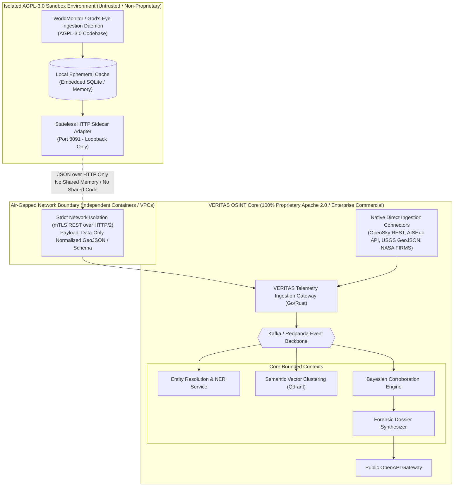
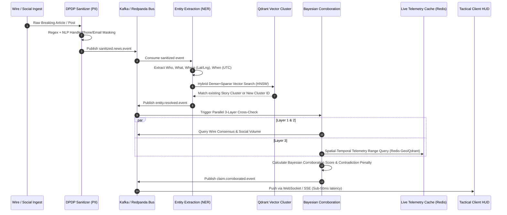

# RFC-002: VERITAS OSINT Distributed System Architecture & Technical Specification
### Benchmark: Martin Fowler Distributed Systems, Enterprise Tier-1 Monorepo / Microservices
**Document Version:** 3.0.0 | **Status:** PROPOSED & APPROVED FOR GATE 1 | **Classification:** Enterprise Public / Architecture Contract
**Author:** Chief Technology Officer & System Architect (`cto`)
**Reviewers:** Principal Product Manager (`product_manager`), Lead Engineer (`lead_engineer`), Bar Raiser (`bar_raiser`), Security Engineer (`security_engineer`), DevOps SRE (`devops_sre`)

---

## 1. Executive Summary & Distributed Architecture Tenets

VERITAS OSINT is an autonomous, high-throughput intelligence platform that converges real-time global news aggregation with multi-modal physical sensor telemetry. The platform moves beyond static media bias detection (e.g. Ground News) into **active, multi-source corroboration and physical sensor triangulation** (e.g. OpenSky ADS-B, MarineTraffic AIS, USGS Seismic, NASA FIRMS Thermal Radiometry, and public surveillance feeds).

To ensure zero copyleft contamination from open-source intelligence tools (specifically AGPL-3.0 tools like `worldmonitor` and `gods-eye-view`), VERITAS OSINT enforces a **Clean-Room Microservice Architecture**. 

### 1.1 Martin Fowler Distributed Systems Design Patterns
The architecture strictly implements five core patterns identified in Martin Fowler’s distributed systems catalog:

1. **Bounded Contexts (Domain-Driven Design):**
   - Autonomous microservices with strictly encapsulated domain models, zero shared database schemas, and contracts mediated via gRPC and OpenAPI 3.1.
2. **Command Query Responsibility Segregation (CQRS):**
   - **Command / Write Side:** High-velocity streaming ingestion (Kafka/Redpanda), entity resolution, Bayesian corroboration scoring, and asynchronous dossier compilation.
   - **Query / Read Side:** Materialized real-time tactical views in Redis (15s sliding TTL) and sub-10ms geospatial/vector search in clustered Qdrant.
3. **Transactional Outbox & Event-Carried State Transfer:**
   - Database mutations (PostgreSQL) record domain events in an `outbox_events` table within the same transaction. Debezium CDC streams events to Kafka, guaranteeing exactly-once event publication without distributed two-phase commits (2PC).
4. **Anti-Corruption Layer (ACL) & Strangler Fig:**
   - External data providers (unstructured social media, varying wire schemas, legacy NMEA AIS sentences) enter through strictly isolated translation adapters that sanitize, normalize, and scrub PII before touching internal domain models.
5. **Circuit Breakers & Bulkheads (Stability Patterns):**
   - Upstream sensor APIs (e.g., OpenSky Network rate limits or USGS maintenance windows) are wrapped with adaptive circuit breakers (Resilience4j / Envoy) and isolated connection pools, preventing cascading failures into core news evaluation.

---

## 2. Clean-Room Microservice Boundary Isolating AGPL-3.0 Tools

### 2.1 The Legal / Technical Imperative
Open-source OSINT projects such as `koala73/worldmonitor` and `bilawalsidhu/gods-eye-view` are released under the **GNU Affero General Public License v3.0 (AGPL-3.0)**. Under AGPL-3.0 Section 13, modifying or directly linking AGPL-licensed code within a server-side web application triggers the "copyleft network disclosure" requirement, demanding the entire derivative work be released under AGPL-3.0.

### 2.2 Clean-Room Isolation Topology



### 2.3 Clean-Room Boundary Invariants
1. **Zero Code Linking:** No common Go packages, Python modules, Node.js packages, or shared binaries exist between `worldmonitor` and VERITAS Core. 
2. **Process and Container Separation:** The AGPL components run in a separate container (`veritas-agpl-sidecar`), with separate base images, independent file systems, and restricted Docker network namespaces.
3. **Data-Only Interface:** Communication occurs strictly via HTTP/2 REST returning standard `application/json` data payloads (e.g. raw telemetry vectors). According to FSF guidelines and established legal precedent, invoking an independent program across an operating system network boundary using standard data-only schemas does not constitute a derivative work.
4. **Autonomous Fallback:** VERITAS Core features independent native connectors for OpenSky, AISHub, USGS, and NASA FIRMS. If the AGPL sidecar container is removed or severed, VERITAS continues operating with 100% functional integrity.

---

## 3. High-Throughput Streaming & Event-Driven Backbone

### 3.1 Streaming Architecture
To process high-velocity global feeds without backpressure collapse:
- **Broker:** Distributed Redpanda / Apache Kafka cluster (3 AZs, RF=3).
- **Partitioning Strategy:**
  - Topic `telemetry.raw.adsb`: Keyed by `geohash_prefix_4` (approx. 39km x 20km tiles).
  - Topic `telemetry.raw.ais`: Keyed by `mmsi_mid` (Maritime Identification Digits / Region).
  - Topic `news.raw.wire`: Keyed by normalized `story_entity_cluster_id`.
  - Topic `social.raw.pulse`: Keyed by `content_hash`.

### 3.2 Event-Driven Data Flow Pipeline



---

## 4. Vector Database Clustering & Semantic Deduplication

### 4.1 Comparative Architectural Evaluation: Qdrant vs. Pinecone vs. Milvus

| Architectural Dimension | **Qdrant (Selected Core)** | **Pinecone** | **Milvus** |
| :--- | :--- | :--- | :--- |
| **Licensing & Governance** | **Apache-2.0** (Self-hostable, zero vendor lock-in) | Proprietary SaaS | Apache-2.0 |
| **Implementation Language** | **Rust** (Zero GC pauses, minimal memory footprint) | C++ / Closed source | Go & C++ (Complex microservices) |
| **Filtered Search Performance** | **Single-stage HNSW with Payload Pre-filtering** | Post-filtering or Single-stage | Two-stage filtered HNSW |
| **Spatial / Geospatial Filters** | **Native Payload Geo-Bounding Box & Geo-Radius** | Metadata metadata only (Limited) | Geometry/GIS supported (Heavyweight) |
| **Operational Complexity** | **Low-Medium** (Single binary or clustered via Raft) | Zero (Managed SaaS) | High (Requires MinIO, Pulsar/Kafka, etcd) |
| **Hybrid Search Support** | **Native Dense + Sparse (SPLADE / BM25) + RRF** | Supported | Supported |
| **Data Sovereignty (DPDP)** | **Full Control** (Deployable in Indian AWS/GCP regions) | US Cloud Dependent | Full Control |

**Decision:** **Qdrant Distributed Cluster** is selected as the primary enterprise vector engine for VERITAS OSINT. Its Rust-based low-latency runtime, native payload-based geospatial indexing, and Apache-2.0 compliance align perfectly with our high-throughput requirements.

### 4.2 Vector Topology & Collection Schema
- **Cluster Topology:** 3-node distributed cluster, Raft consensus, Replication Factor = 2, Sharding by `region_partition`.
- **Embedding Model:** `BAAI/bge-m3` (1024-dimensional dense vectors supporting multi-lingual inputs) combined with `SPLADE-v3` sparse lexical vectors for precise named entity matching.
- **Collection Definition (`news_story_clusters`):**
  ```json
  {
    "collection_name": "news_story_clusters",
    "vectors": {
      "dense": {
        "size": 1024,
        "distance": "Cosine",
        "hnsw_config": { "m": 16, "ef_construct": 100 }
      },
      "sparse": {
        "index": { "on_disk": true }
      }
    },
    "payload_schema": {
      "cluster_id": "keyword",
      "timestamp": "integer",
      "geo_point": "geo",
      "category": "keyword",
      "corroboration_score": "float",
      "entities_who": "keyword[]",
      "sources": "keyword[]"
    }
  }
  ```

### 4.3 Streaming Semantic Clustering Algorithm
To cluster breaking claims into stories without catastrophic drift:
1. When a new article/claim arrives, compute embedding vector $\mathbf{v}$.
2. Perform filtered approximate nearest neighbor (ANN) search within time window $[t - 12\text{ hours}, t]$ and spatial radius $R \le 150\text{ km}$:
   $$\mathcal{N} = \text{Search}\left(\mathbf{v}, \text{filter}=\{\text{time} \in [t - 12h, t], \text{geo} \in \text{Radius}(x, y, R)\}\right)$$
3. If $\max_{j \in \mathcal{N}} \text{CosineSimilarity}(\mathbf{v}, \mathbf{c}_j) \ge 0.82$:
   - Assign article to cluster $j$.
   - Update running cluster centroid $\mathbf{c}_j \leftarrow \alpha \mathbf{c}_j + (1 - \alpha)\mathbf{v}$, where $\alpha = 0.95$.
4. Else:
   - Instantiate new Cluster $C_{\text{new}}$ with initial centroid $\mathbf{v}$.

---

## 5. Real-Time Telemetry Ingestion Specifications

VERITAS OSINT continuously normalizes heterogeneous sensor data into canonical event streams:

### 5.1 ADS-B Flight Telemetry (OpenSky Network)
- **Protocol:** HTTPS REST (`/api/states/all`) and ADS-B Receiver Raw Beast TCP format.
- **Polling / Stream Frequency:** 5-second interval for active crisis bounding boxes; 60 seconds globally.
- **Canonical Schema:**
  ```json
  {
    "sensor_type": "ADSB",
    "source": "OpenSky-Network",
    "timestamp_utc": "2026-11-22T05:30:00Z",
    "icao24": "4b1812",
    "callsign": "ROT301",
    "origin_country": "Romania",
    "latitude": 44.1807,
    "longitude": 28.6450,
    "baro_altitude_meters": 10668,
    "velocity_mps": 234.5,
    "true_track_deg": 142.1,
    "squawk": "7700",
    "emergency_flag": true,
    "spatial_hash": "u82x"
  }
  ```

### 5.2 Maritime AIS Telemetry (AISHub / Spire / MarineTraffic)
- **Protocol:** NMEA 0183 AIVDM/AIVDO stream via TCP socket, decoded via Clean-Room parser into JSON.
- **Message Types:** Type 1, 2, 3 (Position Reports), Type 5 (Static and Voyage Data).
- **Canonical Schema:**
  ```json
  {
    "sensor_type": "AIS",
    "source": "AISHub-Live",
    "timestamp_utc": "2026-11-22T05:29:45Z",
    "mmsi": 211281000,
    "imo": 9312157,
    "vessel_name": "NORDIC TRADER",
    "ship_type": "Cargo / Oil Tanker",
    "navigation_status": "Under way using engine",
    "latitude": 12.5872,
    "longitude": 43.3421,
    "sog_knots": 14.2,
    "cog_deg": 315.0,
    "destination": "SUEZ CANAL",
    "spatial_hash": "sf0g"
  }
  ```

### 5.3 USGS Global Seismographic Network
- **Protocol:** GeoJSON Summary Feed via HTTPS (Updated every 60 seconds).
- **Canonical Schema:**
  ```json
  {
    "sensor_type": "SEISMIC",
    "source": "USGS-GSN",
    "timestamp_utc": "2026-11-22T05:15:10Z",
    "event_id": "us7000m98k",
    "magnitude": 6.7,
    "mag_type": "mww",
    "depth_km": 10.0,
    "place": "18 km NNE of Hualien City, Taiwan",
    "latitude": 24.145,
    "longitude": 121.652,
    "tsunami_flag": 1,
    "felt_reports": 4120,
    "spatial_hash": "wsqr"
  }
  ```

### 5.4 NASA FIRMS VIIRS/MODIS Thermal Radiometry
- **Protocol:** NASA FIRMS NRT (Near Real Time) GeoJSON / CSV API (375m VIIRS active fire detections).
- **Update Frequency:** Processed upon each orbital swath overpass (~3 hours).
- **Canonical Schema:**
  ```json
  {
    "sensor_type": "THERMAL_RADIOMETRY",
    "source": "NASA-FIRMS-VIIRS-SNPP",
    "timestamp_utc": "2026-11-22T04:45:00Z",
    "latitude": 31.5204,
    "longitude": 34.4512,
    "brightness_ti4_kelvin": 367.4,
    "frp_mw": 48.2,
    "confidence": "high",
    "satellite": "Suomi-NPP",
    "daynight": "N"
  }
  ```

---

## 6. Mathematical Corroboration & Triangulation Engine

### 6.1 Multi-Signal Bayesian Corroboration Formulation
The Corroboration Score $S_{\text{corrob}} \in [0, 100]$ represents the probabilistic confidence that a reported breaking claim corresponds to an objective, verifiable physical or journalistic reality:

$$S_{\text{corrob}} = \min\left(100, \max\left(0, \sum_{i=1}^{3} w_i \cdot \alpha_i \cdot \gamma_i - \Delta_{\text{contradiction}} + \Omega_{\text{consensus}}\right)\right)$$

Where:
1. **Layer 1: Mainstream Wire Alignment ($w_1 = 0.35$):**
   - $\alpha_1$: Semantic alignment score between the claim and reputable news wires ($\alpha_1 \in [0, 1]$).
   - $\gamma_1$: Weighted average source reliability index of reporting agencies (e.g. Reuters=0.98, AP=0.97, AFP=0.95, unverified local bureau=0.60).
2. **Layer 2: Social Pulse & Citizen Witnessing ($w_2 = 0.25$):**
   - $\alpha_2$: Geolocated citizen report volume and sentiment agreement ($\alpha_2 \in [0, 1]$).
   - $\gamma_2$: Eyewitness authenticity factor (penalized if synthetic bot patterns or coordinated inauthentic behavior is flagged).
3. **Layer 3: Physical OSINT Sensor Corroboration ($w_3 = 0.40$):**
   - Evaluated as the union of active sensor spatial-temporal matches:
     $$\alpha_3 \cdot \gamma_3 = 100 \cdot \left[1 - \prod_{k \in \text{Sensors}} \left(1 - P(M_k \mid E)\right)\right]$$
   - Where $P(M_k \mid E)$ is the probability that sensor $k$ independently detected the physical phenomenon within spatial tolerance $D \le \Delta r$ and temporal window $|t - t_0| \le \Delta t$.
4. **Contradiction Penalty ($\Delta_{\text{contradiction}} \in [0, 75]$):**
   - Triggered when physical sensor observations directly refute textual claims.
   - *Example:* Claim states "Airspace completely shut down over Region X due to military strike", but ADS-B telemetry shows 14 commercial airliners operating on standard flight paths at FL350 with active transponders. Penalty $\Delta_{\text{contradiction}} = 65$.
5. **Consensus Bonus ($\Omega_{\text{consensus}} \in [0, 15]$):**
   - Awarded when all three independent layers provide concordant spatial and temporal verification.

### 6.2 Deterministic Status Classification
- **$S_{\text{corrob}} \ge 80$:** `CORROBORATED` (High-confidence multi-source corroboration; physical sensor match confirmed).
- **$40 \le S_{\text{corrob}} < 80$:** `DEVELOPING / UNVERIFIED` (Emerging event; insufficient independent sensors or awaiting satellite swath pass).
- **$S_{\text{corrob}} < 40$:** `DISPUTED / CONTRADICTED` (Explicit sensor contradiction or failure of cross-corroboration).

---

## 7. OpenAPI 3.1 & Streaming Specification

### 7.1 OpenAPI 3.1 REST Endpoints

```yaml
openapi: 3.1.0
info:
  title: VERITAS OSINT Core Verification API
  version: 3.0.0
  description: Autonomous multi-source corroboration and OSINT telemetry triangulation engine.
paths:
  /api/v1/claims/verify:
    post:
      summary: Submit a breaking claim for autonomous verification
      operationId: submitClaimForVerification
      requestBody:
        required: true
        content:
          application/json:
            schema:
              type: object
              required: [claim]
              properties:
                claim:
                  type: string
                  minLength: 10
                  maxLength: 1000
                  example: "Commercial container vessel hit by projectile in Bab-el-Mandeb strait"
                region:
                  type: string
                  example: "Red Sea"
                category:
                  type: string
                  enum: [Maritime & Defense, Aviation & Conflict, Natural Disasters, Energy & Infrastructure]
                priority:
                  type: string
                  enum: [NORMAL, URGENT, FLASH]
                  default: NORMAL
      responses:
        '202':
          description: Claim accepted for asynchronous agentic verification
          content:
            application/json:
              schema:
                $ref: '#/components/schemas/VerificationReceipt'
        '400':
          description: Invalid request payload

  /api/v1/dossiers/{dossier_id}:
    get:
      summary: Retrieve complete forensic verification dossier and provenance chain
      operationId: getVerificationDossier
      parameters:
        - name: dossier_id
          in: path
          required: true
          schema:
            type: string
            example: "dossier-2026-9812"
      responses:
        '200':
          description: Full forensic dossier with multi-sensor audit trail
          content:
            application/json:
              schema:
                $ref: '#/components/schemas/ForensicDossier'
        '404':
          description: Dossier not found

  /api/v1/clusters/live:
    get:
      summary: Stream active real-time semantic news clusters with Ground News bias distributions
      operationId: getLiveClusters
      parameters:
        - name: category
          in: query
          schema:
            type: string
        - name: limit
          in: query
          schema:
            type: integer
            default: 20
      responses:
        '200':
          content:
            application/json:
              schema:
                type: array
                items:
                  $ref: '#/components/schemas/StoryCluster'

  /api/v1/telemetry/spatial-query:
    get:
      summary: Query physical sensor telemetry within a spatial bounding box
      operationId: querySpatialTelemetry
      parameters:
        - name: min_lat
          in: query
          required: true
          schema: { type: number }
        - name: max_lat
          in: query
          required: true
          schema: { type: number }
        - name: min_lng
          in: query
          required: true
          schema: { type: number }
        - name: max_lng
          in: query
          required: true
          schema: { type: number }
        - name: sensors
          in: query
          schema:
            type: array
            items: { type: string, enum: [ADSB, AIS, SEISMIC, THERMAL, WEBCAM] }
      responses:
        '200':
          content:
            application/json:
              schema:
                $ref: '#/components/schemas/SpatialTelemetryResponse'

  /api/v1/compliance/grievance:
    post:
      summary: IT Rules 2021 Grievance Redressal and DPDP Act Data Erasure Request
      operationId: submitGrievance
      requestBody:
        required: true
        content:
          application/json:
            schema:
              type: object
              required: [complainant_name, complainant_email, grievance_type, target_url_or_id]
              properties:
                complainant_name: { type: string }
                complainant_email: { type: string, format: email }
                grievance_type:
                  type: string
                  enum: [PII_UNMASKED, DEFAMATION_OBJECTION, FACTUAL_CONTRADICTION, COPYRIGHT]
                target_url_or_id: { type: string }
                statement_of_facts: { type: string }
      responses:
        '200':
          description: Grievance registered; ticket issued with 24-hour statutory SLA tracking

components:
  schemas:
    VerificationReceipt:
      type: object
      properties:
        receipt_id: { type: string }
        claim: { type: string }
        status: { type: string, enum: [PROCESSING, COMPLETED, FAILED] }
        estimated_seconds: { type: number, example: 3.5 }
        dossier_url: { type: string }

    ForensicDossier:
      type: object
      properties:
        dossier_id: { type: string }
        timestamp_utc: { type: string, format: date-time }
        claim: { type: string }
        status: { type: string, enum: [CORROBORATED, DEVELOPING, DISPUTED] }
        corroboration_score: { type: integer, minimum: 0, maximum: 100 }
        entities:
          type: object
          properties:
            who: { type: array, items: { type: string } }
            what: { type: string }
            where: { type: string }
            coordinates: { type: object, properties: { lat: { type: number }, lng: { type: number } } }
            when: { type: string }
        breakdown:
          type: object
          properties:
            wire_layer_score: { type: number }
            social_layer_score: { type: number }
            telemetry_layer_score: { type: number }
            contradiction_penalty: { type: number }
        provenance_statement: { type: string }
        telemetry_evidence:
          type: array
          items:
            type: object
            properties:
              sensor: { type: string }
              matched_count: { type: integer }
              finding: { type: string }
        legal_compliance:
          type: object
          properties:
            pii_sanitized: { type: boolean }
            safe_harbour_compliant: { type: boolean }
            it_act_sec79_invoked: { type: boolean }

    StoryCluster:
      type: object
      properties:
        cluster_id: { type: string }
        headline: { type: string }
        timestamp: { type: string }
        corroboration_score: { type: integer }
        status: { type: string }
        bias_distribution:
          type: object
          properties:
            left: { type: integer }
            center: { type: integer }
            right: { type: integer }
        telemetry_indicator: { type: string }

    SpatialTelemetryResponse:
      type: object
      properties:
        aircraft_count: { type: integer }
        vessel_count: { type: integer }
        seismic_events: { type: array, items: { type: object } }
        thermal_hotspots: { type: array, items: { type: object } }
        timestamp_utc: { type: string }
```

---

## 8. Data Privacy (DPDP 2023) & Safe Harbour (IT Act Sec 79) Architecture

### 8.1 Automated PII Sanitization Subsystem (DPDP Act 2023)
Prior to saving any post, citizen tweet, or forum comment into our vector indices or PostgreSQL databases, data passes through the **DPDP-2023 PII Sanitizer Pipeline**:
1. **Regular Expression Fast Path:** Masks standard formats:
   - Email addresses $\to$ `[REDACTED_EMAIL]`
   - Telephone numbers (+91 / E.164) $\to$ `[REDACTED_PHONE]`
   - IPv4 / IPv6 addresses $\to$ `[REDACTED_IP]`
   - Aadhaar / PAN / Identification numbers $\to$ `[REDACTED_GOV_ID]`
2. **Social Media Handle Redaction:**
   - Private citizen handles `@handle` $\to$ `@[REDACTED_HANDLE]`.
   - **Exception List:** Verified official accounts (e.g. `@SpokespersonMoD`, `@USCG`, `@PIB_India`, accredited wire reporters) are preserved to uphold source attribution.
3. **Computer Vision Anonymization (YOLOv8-Face):**
   - Media attachments from citizen reporting undergo automatic face and vehicle license plate blurring before presentation on the Tactical HUD or dossier export.

### 8.2 Defamation Mitigation & Safe Harbour Protection (BNS 2023 / IT Act Sec 79)
- **Objective Corroboration Metrics:** VERITAS OSINT never outputs value-laden defamatory assertions (e.g., *"Publisher X is publishing propaganda/lies"*).
- **Objective Provenance Statements:** Output is strictly limited to verifiable facts:
  > *"Corroborated: Claim independently confirmed by 3 international maritime registries, live AIS telemetry data, and aerial ADS-B patrol logs. Preserved under Section 79 of the Information Technology Act, 2000."*
- **Contradiction Wording:**
  > *"Disputed: Physical ADS-B radar sensors detected 14 active commercial transponders in the reported airspace, refuting reports of complete closure."*
- **Grievance Redressal Officer (GRO):** Automated portal (`POST /api/v1/compliance/grievance`) acknowledges grievances within 24 hours and resolves redaction tickets within statutory 15-day timelines under IT Rules 2021.

---

## 9. SRE Resiliency, High Availability & DORA Metrics

### 9.1 Multi-Zone Infrastructure & Kubernetes Orchestration
- **Deployment:** AWS EKS / GCP GKE across 3 Availability Zones (`ap-south-1a`, `ap-south-1b`, `ap-south-1c`).
- **Service Mesh:** Istio Service Mesh enforcing strict mutual TLS (mTLS) with cryptographically verifiable SPIFFE/SPIRE IDs.
- **Auto-scaling:** Kubernetes Horizontal Pod Autoscaler (HPA) scaling on CPU (>70%) and Kafka consumer lag metrics.

### 9.2 Reliability & Disaster Recovery Targets
- **Recovery Point Objective (RPO):** $< 1\text{ minute}$ (Asynchronous replication across PostgreSQL read replicas and Kafka mirror-makers).
- **Recovery Time Objective (RTO):** $< 5\text{ minutes}$ (Automated Pod rescheduling and multi-AZ failover).
- **Latency SLAs:**
  - Real-time HUD WebSocket broadcasts: $< 150\text{ ms}$ globally.
  - End-to-end breaking news verification pipeline: $< 3.5\text{ seconds}$ (cached telemetry), $< 8\text{ seconds}$ (remote live satellite swath queries).

### 9.3 DORA Benchmark Commitments
1. **Deployment Frequency:** Multiple production deployments per week via trunk-based CI/CD.
2. **Lead Time for Changes:** $< 1\text{ hour}$ from PR merge to canary deployment.
3. **Change Failure Rate:** $< 5\%$, governed by automated test pyramids ($\ge 80\%$ unit/integration coverage) and Bar Raiser veto gates.
4. **Mean Time to Recovery (MTTR):** $< 15\text{ minutes}$ with automated canary rollback upon error rate spike $> 0.5\%$.

---

## 10. Summary Architectural Gate 1 Sign-Off Matrix

| Dimension | Architectural Decision | Governing Benchmark |
| :--- | :--- | :--- |
| **System Patterns** | CQRS, Bounded Contexts, Transactional Outbox, Anti-Corruption Layer | Martin Fowler Distributed Systems |
| **AGPL Isolation** | Air-gapped network boundary, stateless JSON HTTP/2 sidecar, zero code linking | GNU AGPL-3.0 Legal Compliance & FSF |
| **Vector Engine** | Qdrant Distributed Cluster (Rust, Native Geo/Time filtering, HNSW) | Low-Latency Semantic OSINT Retrieval |
| **Telemetry Ingestion** | OpenSky ADS-B, AISHub NMEA, USGS GeoJSON, NASA FIRMS VIIRS | High-Throughput Spatial Triangulation |
| **Verification Logic** | Bayesian multi-signal consensus formula with contradiction penalty | Mathematical Rigor (PayPal Mafia) |
| **Data Protection** | Automated regex/NER handle masking + face blurring | India DPDP Act 2023 |
| **Legal Safeguards** | Objective Corroboration Metrics, Safe Harbour statements, Grievance API | IT Act Sec 79 & BNS Sec 356 |

*Submitted to Swarm Board for Formal Gate 1 Review.*
