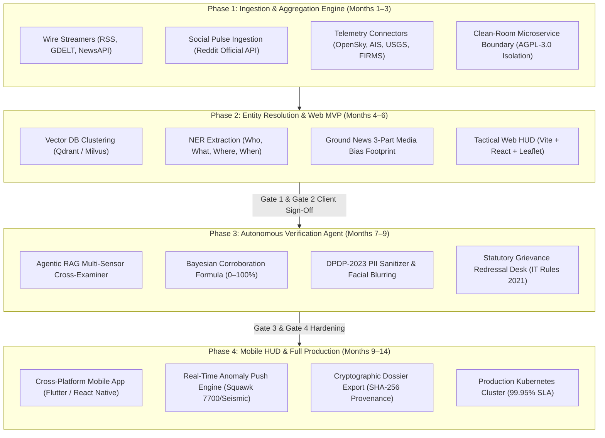

# VERITAS OSINT — Master Product Roadmap & Delivery Strategy
### 4-Phase Rollout Plan: From Web MVP (Months 4–6) to Full Autonomous Production (Months 9–14)
**Author:** Principal Product Manager (`product_manager`)  
**Benchmarked Against:** Amazon Working Backwards & Stripe Product Strategy Standards  
**Version:** 1.0.0 | **Gate:** Gate 0 / Gate 1 Sign-Off  
**Date:** November 22, 2026  

---

## 1. Product North Star & Strategic Vision

### 1.1 The Core Mission
VERITAS OSINT solves the crisis of digital trust by transforming breaking news verification from subjective ideological debate into an objective, mathematical science verified against physical sensor telemetry.

### 1.2 Core Product Tenets (Amazon Style)
1. **Physical Telemetry is the Ultimate Truth Anchor:** Human reporters and viral social posts may spin or hallucinate; ADS-B transponders, AIS beacons, seismic waves, and satellite thermal signatures do not lie.
2. **Corroboration Metrics, Not Truth Judgments:** We never defame publishers or label content as "Fake News". We deliver transparent mathematical confidence scores backed by explicit provenance citations, preserving Section 79 IT Act Safe Harbour and Section 356 BNS compliance.
3. **Sub-4-Second Speed to Truth:** Breaking rumors spread in seconds. Autonomous verification must return corroboration dossiers in $< 3.5\text{ seconds}$ for cached telemetry and $< 8.0\text{ seconds}$ for live sensor sweeps.
4. **Radical Auditability & Source Transparency:** Every badge, score, or contradiction must be drill-down inspectable down to raw sensor timestamps, lat/lon coordinates, and official wire dispatches.
5. **Zero Copyleft Contamination:** Clean-room microservice isolation guarantees that AGPL-3.0 tools (e.g. `worldmonitor`) never compromise our proprietary IP or client deployments.

---

## 2. Customer Persona Matrix & User Journeys

| Persona | Archetype | Primary Pain Point | Core Jobs-To-Be-Done (JTBD) | Key Feature Delight |
| :--- | :--- | :--- | :--- | :--- |
| **Maya Sen** | Investigative Journalist & Fact-Checker | High latency (30-60m) to manually verify viral claims during breaking crises; fear of defamation retractions. | "When breaking rumors emerge, I need an instant, cited forensic dossier with physical sensor proofs so I can publish verified truth before competitor outlets." | Automated 5-step verification dossier with downloadable audit PDF and inline wire/sensor citations. |
| **David Kumar** | Geopolitical & Defense Risk Analyst | Juggling 5 disconnected tools (FlightRadar, MarineTraffic, GDELT, Sentinel) during naval/airspace incidents. | "When a strategic choke point or airspace is disputed, I need a single tactical HUD that overlays breaking news directly onto physical sensor feeds." | Dark matter Leaflet map with live ADS-B squawk 7700 alerts, maritime AIS choke-point corridors, and FIRMS satellite thermal overlays. |
| **Aarav Patel** | Discerning Digital Citizen | Algorithmic polarization, clickbait, and ideological echo chambers on social media feeds. | "When I read a breaking headline, I want to know who is reporting it, who is ignoring it, and whether it physically happened." | Ground News-style 3-part Left/Center/Right bias distribution paired with an objective Corroboration Meter and Ask AI Copilot. |
| **Elena Rostova** | Corporate Security & Supply Chain Director | Late awareness of physical disruptions (port closures, refinery fires, seismic hazards) affecting cargo assets. | "I need automated sensor anomaly alerts tied to localized wire reports so I can reroute shipments hours before mainstream news reports." | Real-time push notifications for seismic M6.0+, AIS anchor drops in subsea corridors, and sudden flight altitude drops. |

---

## 3. Four-Phase Rollout Roadmap



### Phase Breakdown

#### Phase 1: Ingestion & Aggregation Engine (Months 1–3)
- **Objective:** Establish fault-tolerant, continuous streaming pipelines across wire services, social signals, and public telemetry APIs.
- **Key Deliverables:**
  - RSS & GDELT polling engine normalizing international wires.
  - Social Pulse consumer using official Reddit REST APIs with automated rate-limiting.
  - Telemetry connectors for OpenSky Network (ADS-B), AIS maritime feeds, USGS Earthquake Hazards, and NASA FIRMS 375m active fire data.
  - Stateless Clean-Room Microservice isolating any AGPL-3.0 references (`worldmonitor` / `gods-eye-view`) over strictly typed HTTP/JSON contracts.
- **Risk Gate:** Zero AGPL-3.0 dependencies in core repositories; automated circuit breakers on external sensor APIs.

#### Phase 2: Entity Resolution, Vector Clustering & Web HUD MVP (Months 4–6)
- **Objective:** Launch the functional Web MVP delivering unified news clustering, media bias profiling, and the tactical geospatial HUD.
- **Key Deliverables:**
  - Vector embedding and clustering pipeline using Qdrant/Milvus to deduplicate breaking stories across dozens of outlets.
  - Deterministic and probabilistic Named Entity Recognition (NER) pipeline parsing Who, What, Where (geocoded lat/lon), and When (UTC normalized).
  - Ground News-style media bias engine computing Left, Center, and Right coverage ratios and identifying underreported blindspots.
  - Production Web Tactical HUD built with Vite, React, Tailwind CSS, and Leaflet dark-matter maps.
- **Milestone Gate (Gate 1 & 2 Sign-Off):** Client accepts functional Web MVP operating with mock and live streaming telemetry fixtures.

#### Phase 3: Autonomous Verification Agent & Consensus Engine (Months 7–9)
- **Objective:** Deploy the autonomous multi-hop verification agent, Bayesian scoring formula, and statutory legal guardrails.
- **Key Deliverables:**
  - Agentic RAG pipeline performing 3-layer cross-checks (Wire, Social Pulse, OSINT Telemetry) against extracted claim entities.
  - Mathematical Bayesian Corroboration Scoring engine ($S_c \in [0, 100\%]$) with dynamic sensor weights and contradiction deductions.
  - Interactive "Ask AI Dossier Copilot" embedded in every breaking story.
  - Automated DPDP Act 2023 PII Sanitizer (facial blurring on eyewitness photos, handle hashing).
  - IT Intermediary Rules 2021 Grievance Redressal Desk with automated ticketing and 24-hour statutory acknowledgment tracking.
- **Milestone Gate (Gate 3 Security & Legal Sign-Off):** Zero critical security vulnerabilities, 100% PII masking verification, Safe Harbour legal compliance review signed off.

#### Phase 4: Cross-Platform Mobile HUD & Full Autonomous Production App (Months 9–14)
- **Objective:** Expand to native mobile platforms, continuous background anomaly alerting, and enterprise-grade scale.
- **Key Deliverables:**
  - High-performance cross-platform mobile application (Flutter / React Native) with offline caching and tactical dark mode.
  - Real-time notification engine pushing critical physical anomalies (squawk 7700 emergency broadcasts, $\ge \text{M}6.0$ earthquakes in populated zones, naval blockade choke-point stalls).
  - Enterprise forensic dossier export producing cryptographically signed PDF and JSON reports with SHA-256 telemetry provenance hashes.
  - Kubernetes cluster auto-scaling with multi-region redundancy, achieving 99.95% system uptime SLA.
- **Milestone Gate (Gate 4 & 5 Production Acceptance):** Full production launch accepted by Executive Product Owner.

---

## 4. Epic & Sprint Mapping

```
Sprint Cycle 1-2 (Months 1–2): Ingestion Foundations & Telemetry Connectors
├── TSK-101: Ingestion API connectors (GDELT, RSS, Reddit)
├── TSK-102: Telemetry workers (OpenSky ADS-B, Marine AIS, USGS, FIRMS)
└── TSK-103: Clean-room proxy boundary architecture

Sprint Cycle 3-4 (Months 3–4): Vector Clustering & Entity Extraction
├── TSK-201: Qdrant vector clustering service
├── TSK-202: NER pipeline (Who, What, Where, When)
└── TSK-203: Ground News bias footprint & blindspot calculator

Sprint Cycle 5-6 (Months 5–6): Web MVP Release & Tactical HUD
├── TSK-301: Leaflet geospatial dark matter interface
├── TSK-302: Breaking news cards with bias distribution bars
└── TSK-303: Live claim verification modal (Web MVP Delivery)

Sprint Cycle 7-8 (Months 7–8): Agentic RAG & Corroboration Engine
├── TSK-401: Parallel 3-layer cross-check dispatcher
├── TSK-402: Bayesian corroboration scoring formula
└── TSK-403: Ask AI Dossier Copilot integration

Sprint Cycle 9-10 (Months 9–10): Legal Hardening & PII Sanitization
├── TSK-501: DPDP-2023 automated facial blurring & handle masking
├── TSK-502: IT Rules 2021 Grievance Redressal Desk & ticket ledger
└── TSK-503: Sec 356 BNS / Sec 79 IT Act provenance report generator

Sprint Cycle 11-14 (Months 11–14): Mobile App & Enterprise Scale
├── TSK-601: Flutter/React Native mobile UI implementation
├── TSK-602: Real-time telemetry anomaly push notifications
└── TSK-603: Enterprise forensic dossier export with SHA-256 signatures
```

---

## 5. Key Performance Indicators (KPIs) & SLOs

| Category | Metric | MVP Target (Mo 4-6) | Full Production Target (Mo 9-14) |
| :--- | :--- | :--- | :--- |
| **Performance** | Claim Corroboration Latency | $\le 4.5\text{ seconds}$ | $\le 3.5\text{ seconds}$ (cached), $\le 8\text{s}$ (live) |
| **Accuracy** | Contradiction Detection Precision | $\ge 95.0\%$ | $\ge 98.5\%$ against gold-standard ground truth |
| **Reliability** | API & Pipeline Availability | $\ge 99.5\%$ | $\ge 99.95\%$ high-availability multi-region SLA |
| **Privacy** | Non-Public PII Masking Accuracy | $100\%$ | $100\%$ automated DPDP-2023 compliance |
| **Legal** | Defamation Claims & Takedowns | 0 unresolved disputes | $< 24\text{h}$ statutory acknowledgment rate |
| **Engagement** | User Dossier Deep Dives | $\ge 2.5\text{ mins}$ avg session | $\ge 4.5\text{ mins}$ avg session, $\ge 35\%$ copilot query rate |

---

## 6. Swarm Disciplines Handoff Matrix

- **To CTO (`cto`):** Architecture RFC must implement clean-room isolation for AGPL-3.0 tools, Qdrant vector clustering, and sub-4s latency SLA contracts.
- **To Lead Engineer (`lead_engineer`):** Implement the 5-step autonomous loop (`claimExtractor`, `piiSanitizer`, `crossCheckEngine`, `corroborationScorer`, `legalDossierGenerator`).
- **To UI/UX Designer (`ui_ux_designer`):** Deliver the dark matter HUD, Ground News 3-part bias bars, Leaflet tactical layers, and mobile wireframes adhering to WCAG 2.2 AA.
- **To QA Engineer (`qa_engineer`):** Build test suites ensuring $\ge 80\%$ test coverage on scoring algorithms, PII sanitization regexes, and contradiction edge cases.
- **To Security Engineer (`security_engineer`):** Audit STRIDE matrix, DPDP 2023 compliance, Section 356 BNS defamation protections, and IT Rules 2021 Grievance Desk.
- **To DevOps / SRE (`devops_sre`):** Multi-stage Docker containerization, docker-compose orchestration, CI/CD pipelines, and telemetry health monitors.
- **To Bar Raiser (`bar_raiser`):** Adversarial stress-testing of multi-sensor corroboration against GPS spoofing, AIS manipulation, and deepfake media.
