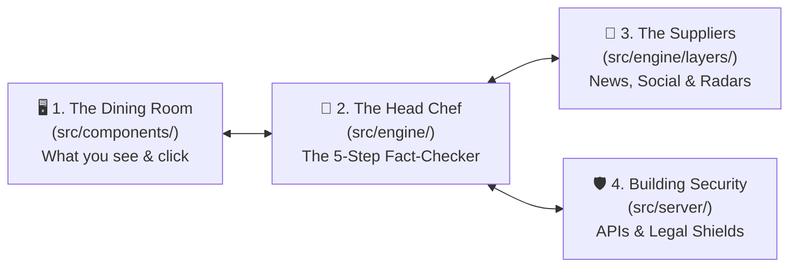

# 🧭 Beginner's Guided Development Plan: Master & Build Your AI News Feed with Antigravity

Welcome! This guide is written in **plain, everyday English**—no heavy computer science jargon. 

Its goal is twofold:
1. **Help you understand how your app actually works** under the hood using simple real-world analogies.
2. **Give you a step-by-step "Learn-by-Doing" Development Plan** where you use **Antigravity** (your AI coding partner) to run, customize, and expand the application while learning how modern software is built.

---

## Part 1: What Is This App, Really? (The "Restaurant" Analogy)

Think of **VERITAS OSINT** as a **24/7 Automated Fact-Checking Newsroom**. When a big rumor breaks on the internet (for example, *"A cargo ship was attacked in the Red Sea"* or *"All flights over the Black Sea are shut down"*), most news apps just repeat what people are saying. 

Your app does something much smarter: **it checks physical reality** (live airplanes, ships, earthquakes, and satellites) before deciding if a story is true.

To understand how the code is organized, imagine a high-end restaurant:

### 1. 🖥️ The Dining Room (`src/components/` & `src/App.jsx`)
* **What developers call it:** The **Frontend** or **UI (User Interface)** (built with *React* and *Tailwind CSS*).
* **What it actually is:** Everything you see on your screen—the dark-mode dashboard, the clickable globe map ([GodsEyeMap.jsx](file:///d:/Google/AI%20news%20feed/src/components/GodsEyeMap.jsx)), the news cards with Left/Center/Right bias bars ([NewsCard.jsx](file:///d:/Google/AI%20news%20feed/src/components/NewsCard.jsx)), and the pop-up reports ([VerificationDossier.jsx](file:///d:/Google/AI%20news%20feed/src/components/VerificationDossier.jsx)).

### 2. 🧠 The Head Chef (`src/engine/`)
* **What developers call it:** The **Core Verification Engine**.
* **What it actually is:** The "brain" of your app. Whenever you type a rumor into the **"Verify Breaking Claim"** box, the Head Chef runs a strict **5-Step Recipe**:
  1. **Step 1 — Check for Duplicates ([ingestionTrigger.js](file:///d:/Google/AI%20news%20feed/src/engine/ingestionTrigger.js)):** Have we already checked this exact rumor in the last 2 hours? And how urgent is it?
  2. **Step 2 — Spot the Clues ([claimExtractor.js](file:///d:/Google/AI%20news%20feed/src/engine/claimExtractor.js)):** Pulls out the **Who, What, Where, and When**, and finds the exact GPS coordinates on a world map.
  3. **Step 3 — Ask 3 Independent Witnesses ([crossCheckEngine.js](file:///d:/Google/AI%20news%20feed/src/engine/crossCheckEngine.js)):** Sends three scouts out at the exact same time:
     * *Witness 1 (Mainstream News Wires)*: What are Reuters and Associated Press saying? ([wireLayer.js](file:///d:/Google/AI%20news%20feed/src/engine/layers/wireLayer.js))
     * *Witness 2 (Social Media Eyewitnesses)*: What are locals posting on Reddit? (It also automatically blurs out private phone numbers, emails, and usernames so nobody gets doxxed! — [piiSanitizer.js](file:///d:/Google/AI%20news%20feed/src/engine/piiSanitizer.js))
     * *Witness 3 (Physical Sensors)*: What do flight radars, ship trackers, earthquake meters, and NASA satellites show right now? ([telemetryLayer.js](file:///d:/Google/AI%20news%20feed/src/engine/layers/telemetryLayer.js))
  4. **Step 4 — Calculate the Truth Score ([corroborationScorer.js](file:///d:/Google/AI%20news%20feed/src/engine/corroborationScorer.js)):** Gives the story a score from **0% to 100%**. If someone claims *"The sky is closed to airplanes"*, but Witness 3 sees 14 airplanes flying there right now, the app subtracts **65 points** and flags the story as **DISPUTED (Red)**!
  5. **Step 5 — Print the Official Dossier ([dossierSynthesizer.js](file:///d:/Google/AI%20news%20feed/src/engine/dossierSynthesizer.js)):** Packages the final report with a legal safety statement (so you can't be sued for defamation) and puts a digital wax seal (cryptographic hash) on it.

### 3. 🛡️ Building Security & Back Office (`src/server/` & `tests/`)
* **What developers call it:** The **Backend API** and **Automated Test Suite**.
* **What it actually is:** Background servers ([apiServer.js](file:///d:/Google/AI%20news%20feed/src/server/apiServer.js)) that block spammers/hackers if they try to flood your app, and automated robots (`tests/`) that double-check that none of your code is broken.

---

## Part 2: How to Use Antigravity as Your Co-Developer

Since you are not a traditional programmer, **you are the Product Director**, and **Antigravity is your Engineering Team**. 

You don't need to memorize code syntax. You just tell Antigravity what you want in plain English, and ask it to explain *what* it changed and *why*.

### 💡 The Golden Formula for Prompting Antigravity
Whenever you want to build or change something, use this 3-part sentence:
> *"1. **[What I want to change]** + 2. **[Where I see it on the screen]** + 3. **[Explain to me in simple terms which file you edited and how it works]**."*

---

## Part 3: Your 5-Module Guided Development & Learning Roadmap

Follow these 5 hands-on modules one by one. In each module, you will copy-paste a prompt to Antigravity, see the result live, and learn a core software concept.

---

### 🟢 Module 1: Turn the Key & Take a Guided Tour (Running the App)
**What you will learn:** How a code folder turns into a live, interactive website on your computer (called a *Local Development Server*).

* **How to do it:** Simply type this into the Antigravity chat:
  > **Prompt to copy-paste:**  
  > *"Start the live development server for this project so I can view the app in my browser, and walk me through the top 3 things I should click first to see how it works."*
* **What happens behind the scenes:** Antigravity runs `npm run dev`. A tool called **Vite** bundles all the files in `src/` and opens a local web address (usually `http://localhost:5173`).
* **Your hands-on experiment:**
  1. Click **"Verify Breaking Claim"** in the top right corner.
  2. Click one of the sample claims and hit **"Execute 5-Step Verification Engine"**.
  3. Click on different colored pins on the **God's Eye Map** and switch between **Dark**, **Satellite**, and **Topo** map styles.

---

### 🔵 Module 2: Your First Visual Customization (Learning the "Frontend")
**What you will learn:** How text, colors, and buttons on the screen are controlled by React Component files (`src/components/`).

* **The Concept:** In React, every box on your screen is its own file. Want to change the top bar? That's [Header.jsx](file:///d:/Google/AI%20news%20feed/src/components/Header.jsx). Want to change how a news story looks? That's [NewsCard.jsx](file:///d:/Google/AI%20news%20feed/src/components/NewsCard.jsx).
* **Your Goal:** Let's customize the app's branding or add a new category filter tab.
* **How to do it — Ask Antigravity:**
  > **Prompt to copy-paste:**  
  > *"I want to learn how the UI components work. Let's add a new category button called 'Cyber & AI Security' to the domain filter bar on the main screen. Make the change for me, and then show me the exact lines you changed in `App.jsx` and explain how React state filters the list."*
* **What you'll learn from this:** You will learn about **State** (`useState`)—which is simply how a webpage remembers which button you currently have selected!

---

### 🟣 Module 3: Teach the Brain a New Country or Region (Learning the "Gazetteer & NER")
**What you will learn:** How the app reads a sentence and figures out where in the world it is happening ([claimExtractor.js](file:///d:/Google/AI%20news%20feed/src/engine/claimExtractor.js)).

* **The Concept:** Right now, the app has an address book (called a `GAZETTEER` in [claimExtractor.js](file:///d:/Google/AI%20news%20feed/src/engine/claimExtractor.js)) of 8 global hotspots (Red Sea, Taiwan, Black Sea, Baltic Sea, Greece, Geneva, Hormuz, Chile). If you type a claim about **Mumbai**, **Panama Canal**, or **Tokyo**, it doesn't know their exact coordinates yet!
* **Your Goal:** Teach the AI engine a brand-new strategic location and add a quick-jump button for it on the God's Eye Map.
* **How to do it — Ask Antigravity:**
  > **Prompt to copy-paste:**  
  > *"I want to teach the verification engine a new location: the 'Mumbai / Arabian Sea Port Sector' (and keywords like 'mumbai', 'arabian sea', 'nhava sheva'). Please add it to the Gazetteer in `claimExtractor.js` AND add a 1-click jump button for it on the God's Eye Map in `mapDataService.js`. Explain in simple terms how the text matcher connects my words to map coordinates."*
* **Your hands-on experiment:** Once Antigravity finishes, click **"Verify Breaking Claim"** and type: *"Cargo vessel reports GPS spoofing near Mumbai Arabian Sea port"*. Watch the map automatically fly to Mumbai and drop a pin!

---

### 🟠 Module 4: Adjust the "Truth Calculator" & Privacy Shield (Learning Business Logic)
**What you will learn:** How rules and math formulas in code decide whether something is trustworthy ([corroborationScorer.js](file:///d:/Google/AI%20news%20feed/src/engine/corroborationScorer.js)) and how privacy filters scrub out personal data ([piiSanitizer.js](file:///d:/Google/AI%20news%20feed/src/engine/piiSanitizer.js)).

* **The Concept:** Currently, the Truth Score gives:
  * **35% weight** to Mainstream News Wires
  * **25% weight** to Social Media Eyewitnesses
  * **40% weight** to Physical Sensors (Radars & Satellites)
  * **-65 point penalty** if a physical sensor proves the rumor is lying.
* **Your Goal:** Test how the privacy filter and the calculator work, and add a new sensor rule.
* **How to do it — Ask Antigravity:**
  > **Prompt to copy-paste:**  
  > *"Show me a live test in the terminal of how `piiSanitizer.js` scrubs out a fake phone number, email, and Twitter handle from an eyewitness post. Then, help me add a new contradiction rule in `telemetryLayer.js` so that if someone claims 'Major tsunami hits coast', but NOAA sea buoys read normal, it flags it as CONTRADICTED."*
* **What you'll learn from this:** You will see how **Deterministic Rules** work—why we don't just let an AI guess, but instead force it to follow strict mathematical and sensor rules.

---

### 🔴 Module 5: Connect Real Live Feeds & Run Safety Checks (APIs & Automated Testing)
**What you will learn:** How your app talks to the outside internet (APIs) and how programmers make sure they didn't accidentally break anything (Automated Tests).

* **The Concept:** 
  * Right now, the **USGS Earthquake layer** on your map fetches **100% real, live earthquakes** from the US Government (`earthquake.usgs.gov`), while the news wires and flight radars use safe, realistic built-in sample data so the app works offline without costing you API money.
  * When you are ready, you can ask Antigravity to plug in real free APIs (like **GDELT** for live global news, **OpenSky Network** for live airplanes, or a **Gemini API Key** for live AI chat).
* **How to run a full safety check anytime:**
  Whenever you and Antigravity finish making changes, ask:
  > **Prompt to copy-paste:**  
  > *"Run the automated test suite (`npm test`) and the chaos resilience test (`npm run test:chaos`) to make sure all our features and legal guardrails are still working properly, and summarize the results for me in plain English."*

---

## Part 4: Quick "Cheat Sheet" — Where Everything Lives

Whenever you want to ask Antigravity about a specific part of the app, here is your quick directory map:

| If you want to change or understand... | Tell Antigravity to look at this file... | What it does in plain English |
| :--- | :--- | :--- |
| **The overall screen layout & filters** | [src/App.jsx](file:///d:/Google/AI%20news%20feed/src/App.jsx) | The main control room that holds the search bar, category buttons, news feed, and map together. |
| **The starter stories on the screen** | [src/data/mockNewsData.js](file:///d:/Google/AI%20news%20feed/src/data/mockNewsData.js) | The 5 pre-loaded breaking stories (Red Sea tanker, Black Sea hoax, Taiwan quake, etc.). |
| **The interactive globe & radar pins** | [src/components/GodsEyeMap.jsx](file:///d:/Google/AI%20news%20feed/src/components/GodsEyeMap.jsx) | Controls the map, satellite view switcher, airplane/ship pins, and earthquake circles. |
| **Live USGS earthquakes & map regions** | [src/services/mapDataService.js](file:///d:/Google/AI%20news%20feed/src/services/mapDataService.js) | Fetches live earthquakes from the internet and stores the 1-click region jump coordinates. |
| **The News Cards & Bias Bar** | [src/components/NewsCard.jsx](file:///d:/Google/AI%20news%20feed/src/components/NewsCard.jsx) | Draws each story card and the Blue/Purple/Red media bias bar. |
| **The pop-up Dossier & AI Chat** | [src/components/VerificationDossier.jsx](file:///d:/Google/AI%20news%20feed/src/components/VerificationDossier.jsx) | The detailed report pop-up and the "Ask AI Dossier Copilot" chat tab. |
| **The "Verify Breaking Claim" pop-up** | [src/components/SubmitClaimModal.jsx](file:///d:/Google/AI%20news%20feed/src/components/SubmitClaimModal.jsx) | The form where you type a new rumor and watch the 5 steps animate. |
| **The 5-Step Brain (Location & Clues)** | [src/engine/claimExtractor.js](file:///d:/Google/AI%20news%20feed/src/engine/claimExtractor.js) | Finds Who, What, Where, When and looks up GPS coordinates in the Gazetteer. |
| **The 0–100% Truth Score Calculator** | [src/engine/corroborationScorer.js](file:///d:/Google/AI%20news%20feed/src/engine/corroborationScorer.js) | The math formula that combines news wires, social media, and physical radar sensors. |
| **The Privacy & Anti-Doxxing Filter** | [src/engine/piiSanitizer.js](file:///d:/Google/AI%20news%20feed/src/engine/piiSanitizer.js) | Automatically hides private emails, phone numbers, and usernames from eyewitness posts. |

---

## 🚀 Ready to Start?
Pick **Module 1** or **Module 2** above, copy-paste the prompt right into this chat, and we will start building and learning together!
