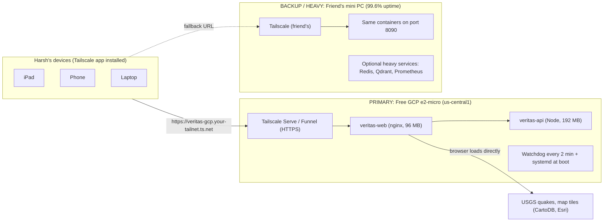

# VERITAS OSINT: 24/7 Hosting Plan (Free GCP VM + Friend's Mini PC Backup)

**Who it's for:** Harsh, who will open the app on his **iPad, phone, and laptop**
**Goal:** The website stays up 24/7, costs ₹0, and restarts itself after crashes and reboots.
**Status:** Deployment files are ready in [`deploy/`](../deploy). Follow the parts below in order.

---

## 1. The Plan in One Picture



**Why the app fits on a free VM:** the website is a static React app. Map tiles and live USGS earthquake data load **straight from those providers into Harsh's browser**, not through the VM. The VM only serves about 500 KB of files, so a 1 GB machine has plenty of headroom and the 1 GB/month free network allowance is enough for personal use.

**Why Tailscale and not a public IP:**

| Problem with a public IP | How Tailscale fixes it |
| :--- | :--- |
| The free VM's IP changes if the VM is stopped | The `veritas-gcp.<tailnet>.ts.net` name never changes |
| An HTTPS certificate needs a domain | Tailscale issues a real HTTPS certificate for free |
| Open ports 80/443 attract bots and attacks | No ports are opened in the GCP firewall |
| A static IP can cost money | Not needed |

The free Tailscale plan covers this (up to 3 users and 100 devices). If anyone without Tailscale needs to open the site, add `--funnel` to make the same URL public.

---

## 2. What Runs Where

| Component | GCP e2-micro (1 GB RAM, 2 shared vCPU, 30 GB disk) | Friend's mini PC |
| :--- | :--- | :--- |
| `veritas-web` (website) | ✅ **Primary** | ✅ Warm standby (port 8090) |
| `veritas-api` (verification API) | ✅ | ✅ |
| Redis, Qdrant vector DB, Prometheus, telemetry worker (full [docker-compose.yml](../docker-compose.yml), ~2 GB RAM) | ❌ Too big for 1 GB | ✅ Only if needed later |
| Estimated RAM | ~200 MB, plus a 2 GB swap safety net | Depends on the friend's other app |

---

## 3. How 24/7 Uptime Is Guaranteed (Defense in Depth)

| Failure | What recovers it automatically | Recovery time |
| :--- | :--- | :--- |
| Container crashes | Docker `restart: always` | ~2 s |
| App hangs (container still running but broken) | `veritas-watchdog` checks `/healthz` every 2 min and restarts the stack after 3 failures | ≤ 6 min |
| Docker daemon dies | Watchdog restarts Docker | ≤ 2 min |
| VM reboots (Google maintenance, kernel update) | `docker.service`, `veritas.service`, and `tailscaled` are all enabled at boot | ~1 min |
| Google host maintenance | e2 VMs **live-migrate** with no reboot (keep the default "On host maintenance: Migrate") | 0 |
| Memory spike | Per-container `mem_limit` plus 2 GB swap prevents the whole VM from freezing | none |
| Disk fills with logs | Docker log rotation (10 MB × 3) and the watchdog prunes when disk use is ≥ 90% | none |
| Security patches | `unattended-upgrades` installs them daily (no automatic reboot, so no surprise downtime) | none |
| Whole VM or GCP region down | Harsh opens the **mini PC fallback URL** | manual, 10 s |
| You need to know it broke | Free UptimeRobot monitor, or a GCP Uptime Check (only works if Funnel is on) | alert by email |

> [!NOTE]
> Realistic target: **about 99.5–99.9%** for the GCP VM alone. With the mini PC as a manual fallback, Harsh is almost never without access. True automatic failover between two machines behind one URL needs a paid load balancer, which this free design leaves out on purpose.

---

## 4. Step-by-Step Guide (Build It in Parts)

Each part ends with a **✅ Done when** check. Don't start the next part until the check passes.

### Part 0: Accounts (≈ 15 min, Harsh does this himself)

1. **Google account:** use Harsh's own Gmail. 2-Step Verification must be on (Google Cloud requires it).
2. **Google Cloud:** go to https://console.cloud.google.com, accept the terms, then **Activate the Free Trial**.
   - A card (or UPI in India) is needed to verify identity. Google may place a small temporary hold, which it refunds.
   - Free Trial: \$300 credit for 90 days. **Always Free (the e2-micro) continues after the trial ends.**
3. **Tailscale:** go to https://login.tailscale.com and click **"Sign in with Google"** using the same Gmail.
4. **Install the Tailscale app on all of Harsh's devices** (iPad App Store, phone, laptop) and sign in with the same Gmail.

✅ **Done when:** Tailscale's admin page lists Harsh's iPad, phone, and laptop.

### Part 1: Create the free VM (≈ 10 min)

1. Console → **select or create a project** (name it `veritas-osint`).
2. **☰ → Compute Engine → VM instances**, then click **Enable API** if asked.
3. Click **Create instance** and set **exactly** these values. Any other value can cost money:

| Setting | Value |
| :--- | :--- |
| Name | `veritas-gcp` |
| Region | **`us-central1` (Iowa)**, `us-west1`, or `us-east1` only |
| Machine type | **E2 → `e2-micro`** (the page shows a "free tier" hint) |
| Provisioning model | **Standard** (not Spot, which can be shut down at any time) |
| Boot disk | **Debian 12**, type **Standard persistent disk**, size **30 GB** |
| Firewall | Leave HTTP/HTTPS **unchecked** (Tailscale doesn't need them) |
| Advanced → Management → Availability | On host maintenance: **Migrate**; Automatic restart: **On** |

4. Click **Create**.
5. **Set a budget alert:** ☰ → **Billing → Budgets & alerts → Create budget**, set ₹100, and alert at 50%, 90%, and 100%. This is your early warning if anything starts charging.

✅ **Done when:** `veritas-gcp` shows a green tick in the VM list.

> [!IMPORTANT]
> Latency from India to a US free-tier region is about 250 ms. That's fine for this app because pages are cached. Free e2-micro VMs only exist in these three US regions.

### Part 2: "The keys": what you actually need

| Key | Needed? | Where it comes from |
| :--- | :--- | :--- |
| SSH key for the VM | **No (automatic)** | The **SSH** button in the GCP console creates and manages it in the browser |
| Tailscale login | **Yes, once** | During install, the VM prints a link. Open it and approve with Harsh's Gmail |
| Tailscale auth key (`tskey-auth-…`) | Optional | Only for a no-browser install: Tailscale admin → Settings → **Keys → Generate auth key** (one-time, 1-hour expiry) |
| GCP service-account JSON key | **No. Don't create one** | Not needed. It is the most commonly leaked Google Cloud credential |

> [!CAUTION]
> Never paste auth keys, passwords, or JSON keys into chat, email, or the Git repo. Treat a Tailscale auth key like a password. If one is exposed, revoke it in the admin console.

Also do this once in the **Tailscale admin console → DNS**: turn on **MagicDNS** and **HTTPS Certificates**. To make the site public, also enable **Funnel** under Access controls; the console offers a one-click button for it.

### Part 3: Install everything on the VM (≈ 15 min, mostly waiting)

**Option A: from the browser only (easiest, works from an iPad too)**
1. In the VM list, click **SSH** next to `veritas-gcp`. A terminal opens in the browser.
2. Upload the project. In the SSH window, use **⚙ → Upload file** to upload the release archive. On the laptop, create it with:
   ```powershell
   cd "d:\Google\AI news feed"
   tar.exe -czf veritas-release.tar.gz --exclude=node_modules --exclude=dist --exclude=.git .
   ```
3. In the browser SSH window:
   ```bash
   mkdir -p ~/veritas && tar -xzf veritas-release.tar.gz -C ~/veritas
   sudo bash ~/veritas/deploy/install-host.sh --name veritas-gcp
   ```
4. When it prints a `https://login.tailscale.com/a/...` link, open it and approve with Harsh's Gmail.

**Option B: from this laptop with one command** (after Option A has run once, or after installing Tailscale on the laptop)
```powershell
cd "d:\Google\AI news feed"
.\deploy\upload.ps1 -Target <your-vm-username>@veritas-gcp -Name veritas-gcp
```

The installer ([install-host.sh](../deploy/install-host.sh)) runs these steps:

1. Adds 2 GB swap
2. Turns on automatic security updates
3. Installs Docker
4. Installs and logs in Tailscale
5. Builds and starts the containers (this runs the 119 tests first, and the build stops if any fail)
6. Installs the boot service and the 2-minute watchdog
7. Publishes the site over HTTPS

The first build takes about 8–12 minutes on an e2-micro.

✅ **Done when:** the script prints `Health check OK` and a `https://veritas-gcp.<tailnet>.ts.net` URL.

### Part 4: Open it on the iPad, phone, and laptop (≈ 2 min)

1. Make sure the Tailscale app shows **Connected** on the device.
2. Open Safari or Chrome and go to `https://veritas-gcp.<your-tailnet>.ts.net`.
3. **iPad/iPhone:** tap Share → **Add to Home Screen** so it opens like an app.

✅ **Done when:** the map, news cards, and Pitch Deck all load on all three devices.

### Part 5: Monitoring and reboot test (≈ 10 min)

1. **Reboot test:** in the SSH window run `sudo reboot`, wait 2 minutes, and reload the site on the iPad. It should come back without you doing anything.
2. **Crash test:** `sudo docker kill veritas-veritas-web-1`, then reload the site within a few seconds. It should already be back.
3. **Alerts (only if Funnel is on):** create a free https://uptimerobot.com HTTP monitor on the public URL `/healthz`, with email alerts.
4. Useful commands:
   ```bash
   sudo docker ps                                   # containers + health
   journalctl -u veritas-watchdog --since today     # watchdog actions
   free -m ; df -h /                                # memory + disk
   ```

✅ **Done when:** both tests recover by themselves.

### Part 6: Updating the app later

Make changes on the laptop, then run the same command again:
```powershell
.\deploy\upload.ps1 -Target <user>@veritas-gcp -Name veritas-gcp
```
It rebuilds, runs the tests, and swaps the containers. Downtime is a few seconds. If the tests fail, the new image isn't built and the old version keeps running.

---

## 5. Friend's Mini PC: Backup and Heavy Services

**What we know:** it runs about 99.6% of the time, already has Tailscale, runs one small app, and its Tailscale/Google login belongs to the friend.

> [!IMPORTANT]
> **Do this only with the friend's explicit permission.** Don't sign into the friend's Gmail on this laptop. Use one of the options below so his account stays his, and he can remove access with one click at any time.

### Choose one option (from easiest for the friend to least)

| Option | What the friend does (≈ 5 min) | What we get |
| :--- | :--- | :--- |
| **A. Friend runs one command** (recommended) | Copies the archive to the mini PC and runs `sudo bash deploy/install-host.sh --name veritas-minipc --port 8090 --skip-tailscale` | Done. No account access needed at all |
| **B. Tailscale node sharing** | Tailscale admin → Machines → mini PC → **Share** → sends the invite to Harsh's Gmail. Then either enables **Tailscale SSH** for Harsh, or adds this laptop's public key to `~/.ssh/authorized_keys` | We deploy from this laptop: `.\deploy\upload.ps1 -Target <friend-user>@veritas-minipc -Name veritas-minipc -Port 8090 -SkipTailscale` |
| **C. One supervised session** | Friend sits with you, logs in himself, and you run Option A's command | Same as A; he logs out afterwards |

After deployment, **no further login is needed**. The containers start at boot and restart on failure through the same `veritas.service` and watchdog. The friend can revoke the share or SSH key at any time without affecting his own app.

### Things to check on the mini PC before installing

1. **OS:** the script needs **Linux (Debian/Ubuntu)**. If it runs **Windows**, install Docker Desktop with WSL2 (set it to "start on login") and run `docker compose -f deploy/docker-compose.free.yml up -d` instead.
2. **Port conflict with his app:** we use **8090** (`--port 8090`). Check it's free with `ss -ltn | grep 8090`.
3. **Resources:** our slim stack is capped at about 290 MB RAM and 1.25 CPU, so it can't starve his app.
4. **Tailscale Serve on his node:** `tailscale serve --bg 8090` publishes it inside his tailnet. Because the machine is shared with Harsh, Harsh can reach it at the fallback URL.

### When to move work to the mini PC

- The GCP VM is consistently using more than 80% RAM, or swap is busy (`free -m`), **or**
- You want the full stack ([docker-compose.yml](../docker-compose.yml): Redis, Qdrant, Prometheus, telemetry ingestion). That needs about 2 GB+, which only the mini PC can provide.

---

## 6. Cost Guardrails (stay at ₹0)

| Rule | Why |
| :--- | :--- |
| Only **one** e2-micro, in us-central1, us-west1, or us-east1 | The free tier covers one instance per month |
| **Standard** persistent disk ≤ 30 GB | Balanced/SSD disks are charged |
| Don't reserve a static IP | Idle reserved IPs are billed hourly. Tailscale makes them unnecessary |
| Keep the ₹100 budget alert | Early warning if anything changes |
| Egress ≤ 1 GB/month | Easy for personal use (~500 KB per first visit, then cached) |
| Don't use Cloud Run, Load Balancer, or Cloud NAT for this | These aren't needed and can cost money |

---

## 7. File Reference

| File | Purpose |
| :--- | :--- |
| [deploy/install-host.sh](../deploy/install-host.sh) | One-shot, re-runnable installer for the GCP VM or the mini PC |
| [deploy/docker-compose.free.yml](../deploy/docker-compose.free.yml) | Slim 2-container stack with memory caps, log rotation, `restart: always` |
| [deploy/Dockerfile.free](../deploy/Dockerfile.free) | Low-memory build (runs the tests, then builds) |
| [deploy/nginx.conf](../deploy/nginx.conf) | Production web server: caching, security headers, `/healthz`, `/api/` proxy |
| [deploy/watchdog.sh](../deploy/watchdog.sh) | 2-minute self-healing checks |
| [deploy/upload.ps1](../deploy/upload.ps1) | One-command deploy and update from this Windows laptop |
