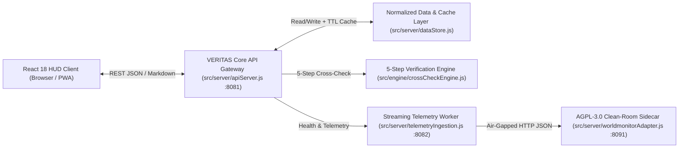
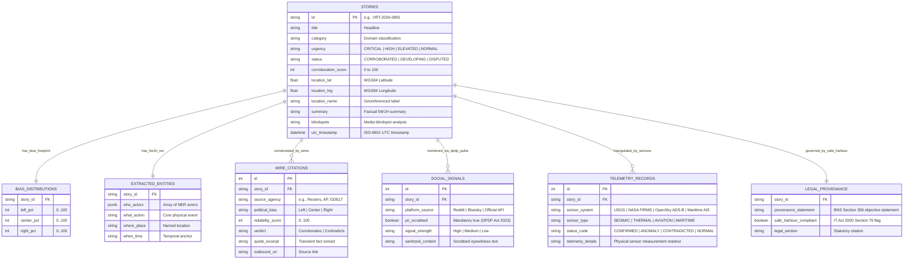

# VERITAS OSINT — Backend System, Data & API Architecture Specification

**Version:** 1.0.0  
**Phase:** Phase 3 — Backend Engineer  
**Source of Truth:** [docs/prd.md](file:///d:/Google/AI%20news%20feed/docs/prd.md) & [docs/design-spec.md](file:///d:/Google/AI%20news%20feed/docs/design-spec.md)  

---

## 1. System Topology & Clean-Room Architecture



---

## 2. Entity-Relationship (ER) Diagram & Normalized Data Schema



### 2.1 SQL Migration Specification (`migrations/001_init_veritas_schema.sql`)

```sql
CREATE TABLE IF NOT EXISTS stories (
    id VARCHAR(64) PRIMARY KEY,
    title TEXT NOT NULL,
    category VARCHAR(64) NOT NULL,
    urgency VARCHAR(32) NOT NULL DEFAULT 'HIGH',
    status VARCHAR(32) NOT NULL CHECK (status IN ('CORROBORATED', 'DEVELOPING', 'DISPUTED')),
    corroboration_score INTEGER NOT NULL CHECK (corroboration_score BETWEEN 0 AND 100),
    location_lat DOUBLE PRECISION NOT NULL,
    location_lng DOUBLE PRECISION NOT NULL,
    location_name VARCHAR(255) NOT NULL,
    summary TEXT NOT NULL,
    blindspots TEXT,
    bias_left INTEGER NOT NULL DEFAULT 33,
    bias_center INTEGER NOT NULL DEFAULT 34,
    bias_right INTEGER NOT NULL DEFAULT 33,
    entities_json JSONB NOT NULL,
    parallel_verification_json JSONB NOT NULL,
    legal_safeguards_json JSONB NOT NULL,
    utc_timestamp TIMESTAMPTZ NOT NULL DEFAULT NOW()
);

-- Hot Query Composite Indexes (Journey 3 Multi-Dimension Filtering)
CREATE INDEX IF NOT EXISTS idx_stories_status_category ON stories (status, category, utc_timestamp DESC);
CREATE INDEX IF NOT EXISTS idx_stories_score ON stories (corroboration_score DESC);
CREATE INDEX IF NOT EXISTS idx_stories_geo ON stories (location_lat, location_lng);
```

---

## 3. Caching Strategy & Invalidation Topology

| Cache Key Pattern | TTL | Strategy | Invalidation Trigger | Target Latency |
| :--- | :--- | :--- | :--- | :--- |
| `feed:query:<hash>` | `60s` | Cache-Aside | Invalidated immediately on `POST /api/v1/verify` (`invalidatePrefix('feed:')`) | `< 15ms` (P99 `< 50ms`) |
| `dossier:<id>` | `300s` | Write-Through | Populated on verification creation or first `GET /api/v1/dossier/:id` | `< 5ms` |
| `telemetry:live` | `30s` | Cache-Aside | Time-based expiry (`30s` sliding window) | `< 25ms` |

---

## 4. REST API Contracts (OpenAPI 3.1 Aligned)

All endpoints emit:
- `X-Request-Id`: Unique trace UUID per request
- `X-Safe-Harbour: Section-79-IT-Act-BNS-356`
- `X-Data-Protection: DPDP-Act-2023-Automated-Scrubbing`

### 4.1 `GET /api/v1/feed` (Alias: `GET /api/feed`)
Returns filtered breaking news stories with Ground News bias distributions and 3-layer telemetry summaries.
- **Query Parameters:**
  - `q` (optional, string): Full-text keyword search across title, summary, location, and 5W1H entities.
  - `category` (optional, string): Domain filter (`ALL`, `Maritime & Defense`, `Aviation & Conflict`, `Natural Disasters`, `Energy & Infrastructure`, `Cyber & AI Security`).
  - `status` (optional, string): `ALL` | `CORROBORATED` | `DEVELOPING` | `DISPUTED`.
  - `bias` (optional, string): `ALL` | `LEFT` | `CENTER` | `RIGHT` | `BLINDSPOT`.
  - `sensor` (optional, string): `ALL` | `SEISMIC` | `THERMAL` | `AVIATION` | `MARITIME`.
- **Response `200 OK`:**
```json
{
  "cached": true,
  "count": 6,
  "filters": { "q": "", "category": "ALL", "status": "ALL", "bias": "ALL", "sensor": "ALL" },
  "stories": [ /* Normalized Story Dossier Objects */ ]
}
```

### 4.2 `POST /api/v1/verify` (Alias: `POST /api/verify`)
Executes the 5-step autonomous verification pipeline, stores the resulting dossier in the data store, and invalidates feed caches.
- **Request Body:**
```json
{
  "claim": "Cargo vessel emergency squawk and thermal anomaly near Bab-el-Mandeb Strait",
  "region": "Middle East",
  "liveMode": false
}
```
- **Validation:** `claim` must be a non-empty string with length $\ge 10$ characters.
- **Response `200 OK`:** Returns `{ dossierId, status, corroborationScore, category, entities, provenanceStatement, telemetryMatches, piiScrubbed, safeHarbourCompliant, dossier }`.
- **Error `400 Bad Request` / `429 Too Many Requests`:**
```json
{
  "error": "Bad Request",
  "code": "INVALID_CLAIM_LENGTH",
  "message": "Claim string is required and must be at least 10 characters long."
}
```

### 4.3 `GET /api/v1/dossier/:id` (Alias: `GET /api/dossier/:id`)
Retrieves a specific verification dossier by ID in JSON, Markdown Brief, or Shareable Card format (Journey 2 - Option C).
- **Query Parameters:**
  - `format`: `json` (default) | `markdown` (returns `text/markdown` attachment) | `share` (returns formatted share card summary payload).
- **Response `200 OK` (`format=json`):** Returns full dossier + `shareCard` summary and `markdownBrief`.
- **Response `200 OK` (`format=markdown`):** Returns `Content-Type: text/markdown; charset=utf-8` intelligence brief.
- **Response `404 Not Found`:** `{ "error": "Not Found", "code": "DOSSIER_NOT_FOUND", "message": "Dossier not found." }`

### 4.4 `GET /api/v1/telemetry` (Alias: `GET /api/telemetry`) & `GET /api/v1/telemetry/health`
Returns unified active OSINT sensor streams (ADS-B, AIS, USGS Seismic, NASA Thermal) and p50/p90/p99 ingestion health metrics.

### 4.5 `GET /healthz`, `GET /readyz`, and `GET /api/v1/metrics`
- `/healthz`: Liveness probe (`200 OK`).
- `/readyz`: Readiness probe verifying data store seed count and cache operational status (`200 OK`).
- `/api/v1/metrics`: Prometheus 4 Golden Signals exposition.
