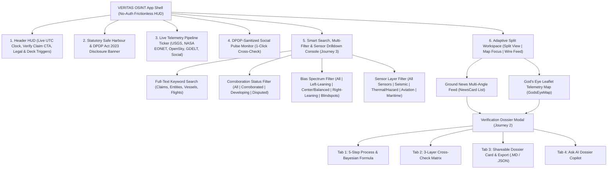
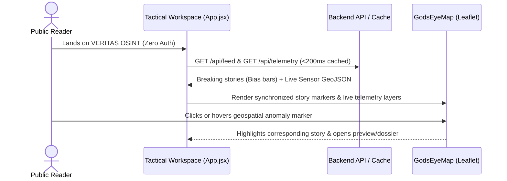
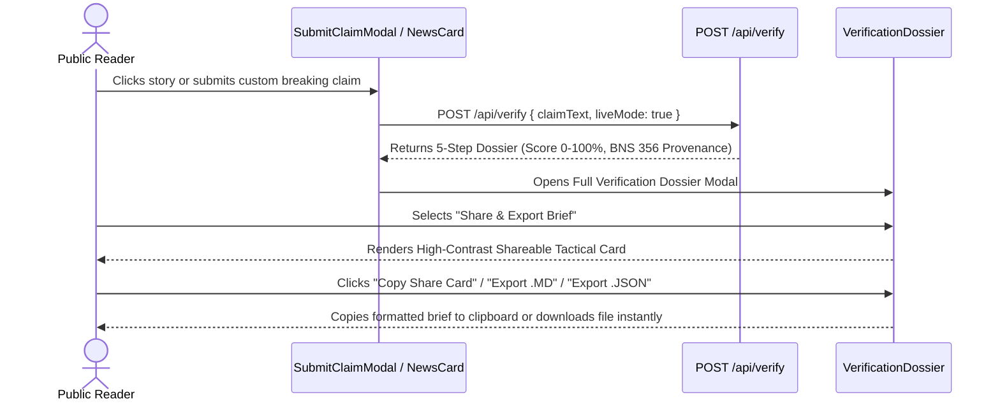
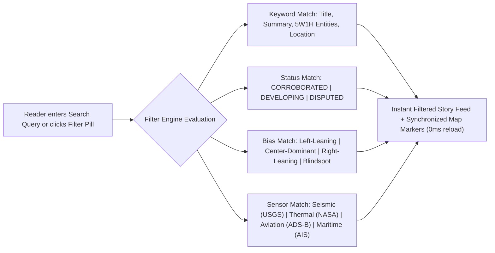

# VERITAS OSINT — UI/UX Interface & Interaction Design Specification

**Version:** 1.0.0  
**Phase:** Phase 2 — UI/UX Engineer  
**Source of Truth:** [docs/prd.md](file:///d:/Google/AI%20news%20feed/docs/prd.md)  
**Aesthetic Direction:** Tactical Dark-Matter Intelligence HUD (Palantir / Stripe / Ground News Benchmark)

---

## 1. Surface Mode Classification

Following the Impeccable Surface Mode taxonomy, every surface in VERITAS OSINT is classified by its cognitive job:

| Surface / View | Surface Mode | Cognitive Goal | Key Design Principle |
| :--- | :--- | :--- | :--- |
| **Main Tactical Workspace (Split HUD)** | `Operate` | Rapid situational awareness, multi-layer filtering, geospatial correlation | High information density, zero visual clutter, monospace telemetry readouts, 1-click drilldowns |
| **God's Eye Geospatial Telemetry Map** | `Operate` | Spatial anomaly tracking (ADS-B, AIS, USGS Seismic, NASA Thermal) | High-contrast vector markers over dark-matter cartography (`#080b11`), collapsible layer drawers |
| **5-Step Verification Dossier Modal** | `Read` | Deep forensic inspection of 5W1H entities, Bayesian score math, and legal provenance | Structured hierarchy, scannable 3-layer evidence matrix, clear legal Safe Harbour callouts |
| **Shareable Dossier Card & Export View** | `Read` / `Persuade` | Instant social/messaging comprehension & portable intelligence brief export | High-contrast summary card, 1-click clipboard copy, dual export (`.md` Markdown & `.json` Forensic) |
| **Submit Breaking Claim Modal** | `Operate` | Frictionless claim submission with live 5-step execution feedback | Real-time step progress indicators, transparent rate-limit status, zero-auth friction |

---

## 2. Information Architecture & Navigation Hierarchy

---

## 3. Core User Flows (Mermaid)

### Flow 1: Live Tactical News & Telemetry HUD (Journey 1)

### Flow 2: 5-Step Claim Verification, Shareable Card & Export (Journey 2 - Option C)

### Flow 3: Smart Search, Bias Spectrum Filter & Sensor Drilldown (Journey 3 - Option B)

---

## 4. Page-by-Page & Component Breakdown

### 4.1 Global Header & Telemetry Bar (`Header.jsx`, `LegalBanner.jsx`, `TelemetryTicker.jsx`)
- **Header HUD:** Displays the `VERITAS OSINT` tactical emblem, live ticking UTC clock (`JetBrains Mono`), total indexed event counter, **"Verify Breaking Claim"** primary neon CTA button, Legal Guardrails trigger, and Investor Deck trigger.
- **Statutory Banner:** Persistent 1-line compliance notice referencing Section 79 IT Act 2000 Safe Harbour & DPDP Act 2023 automated PII scrubbing.
- **Telemetry Pipeline Ticker:** Horizontal status strip displaying real-time connection health (`ONLINE` / `FALLBACK`) and active sensor counts for USGS Seismic, NASA EONET Hazards, OpenSky ADS-B, GDELT Wire, and DPDP Social Pulse.

### 4.2 Smart Search & Multi-Dimension Filter Console (`App.jsx` - Journey 3 Upgrade)
- **Row 1: Search, Corroboration Status, Saved Bookmarks & View Mode Switcher**
  - Full-text search input with clear (`X`) button when active.
  - Status pills: `All`, `Corroborated` (Emerald), `Developing` (Amber), `Disputed` (Rose).
  - LocalStorage Bookmark toggle: `Saved (N)`.
  - View mode switcher: `Split View` (5/7 grid), `Map Focus` (12-col map), `Wire Feed` (12-col feed).
- **Row 2: Domain Categories, Bias Spectrum & Sensor Drilldown**
  - **Domain Pills:** `ALL`, `Maritime & Defense`, `Aviation & Conflict`, `Natural Disasters`, `Energy & Infrastructure`, `Cyber & AI Security`.
  - **Bias Footprint Filter (`biasFilter`):**
    - `ALL BIAS`: No bias restriction.
    - `LEFT-LEANING`: Stories where Left coverage $> 40\%$.
    - `CENTER / BALANCED`: Stories where Center coverage $\ge 45\%$.
    - `RIGHT-LEANING`: Stories where Right coverage $> 40\%$.
    - `BLINDSPOT`: Stories where either Left or Right coverage is $< 15\%$.
  - **Sensor Layer Filter (`sensorFilter`):**
    - `ALL SENSORS`
    - `SEISMIC (USGS)`
    - `THERMAL / NASA`
    - `AVIATION (ADS-B)`
    - `MARITIME (AIS)`

### 4.3 Multi-Angle News Card (`NewsCard.jsx`)
- **Top Metadata Row:** Category badge, Urgency pill (`CRITICAL`, `HIGH`, `MEDIUM`), `LIVE GDELT` indicator badge, location pin, and bookmark star/ribbon button.
- **Headline & Factual Summary:** High-contrast `slate-100` title with 5W1H transient summary.
- **Ground News Bias Bar:** Tri-color horizontal progress bar (`#3b82f6` Left, `#a855f7` Center, `#f43f5e` Right) with exact percentage labels and blindspot warning callout.
- **Corroboration Footer:** Status badge (`CORROBORATED` / `DEVELOPING` / `DISPUTED`), numeric percentage score (`0–100%`), and `"Inspect 5-Step Dossier →"` trigger.

### 4.4 Verification Dossier & Shareable Card / Export Suite (`VerificationDossier.jsx` - Journey 2 Upgrade)
- **Header Actions:**
  - `Save / Saved` bookmark toggle.
  - `Share Card` button (jumps to or opens the Shareable Tactical Card preview & 1-click copy).
  - `Export .MD` button (downloads a clean, human-readable Markdown Intelligence Brief `VERITAS_Brief_<ID>.md`).
  - `Export .JSON` button (downloads raw forensic JSON `VERITAS_Dossier_<ID>.json`).
- **Tab 1: 5-Step Verification Process:** Status banner, Corroboration Score, Geospatial coordinate fix, Bayesian scoring formula box, 5-step pipeline breakdown, and Safe Harbour Legal Provenance statement with 1-click copy.
- **Tab 2: 3-Layer Cross-Check Matrix:** Side-by-side cards for Layer 1 (Mainstream Wire agencies & reliability ratings), Layer 2 (DPDP-scrubbed Social Pulse), and Layer 3 (Hard OSINT Sensor Telemetry).
- **Tab 3: Shareable Intelligence Card (`share` tab):**
  - Renders a self-contained, screenshot-ready **Tactical Verification Card** displaying:
    - VERITAS OSINT watermark, Dossier ID, and UTC timestamp
    - Headline, Geolocation coordinates, and Corroboration Score gauge
    - 3-Layer Verification Checkmarks (Wire, Social DPDP, Physical Sensor)
    - Ground News Bias Distribution Bar
    - Statutory BNS Section 356 / IT Act Section 79 Provenance Footer
  - Action buttons: **"Copy Formatted Text Brief to Clipboard"**, **"Copy Permalink"**, **"Download Markdown Brief (.MD)"**, and **"Download Forensic JSON (.JSON)"**.
- **Tab 4: Ask AI Dossier Copilot:** Interactive Q&A chat panel allowing readers to query sensor telemetry, bias splits, and legal provenance.

---

## 5. Design Tokens & Visual System

### 5.1 Color Palette (Semantic Tokens)
| Token | Hex | Usage | Contrast vs `#080b11` |
| :--- | :--- | :--- | :--- |
| `osint-950` | `#080b11` | App primary background canvas | — |
| `osint-900` | `#0a0d14` | Header, card headers, modal Chrome | 1.1:1 (Surface elevation) |
| `osint-850` | `#0f1420` | Card body, modal container surface | 1.3:1 (Bordered container) |
| `osint-accent` | `#00f0ff` | Primary tactical cyan accent, active tabs, radar highlights | 13.4:1 (AAA) |
| `osint-neonGreen` / `emerald-400` | `#34d399` | `CORROBORATED` status ($\ge 75\%$), healthy sensor streams | 10.8:1 (AAA) |
| `osint-neonAmber` / `amber-400` | `#fbbf24` | `DEVELOPING` status ($40\text{--}74\%$), blindspot alerts, bookmarks | 11.9:1 (AAA) |
| `osint-neonRed` / `rose-400` | `#fb7185` | `DISPUTED` status ($< 40\%$), physical sensor contradiction | 6.8:1 (AA) |
| `osint-biasLeft` | `#3b82f6` | Left-leaning media coverage bar segment | 5.3:1 (AA) |
| `osint-biasCenter` | `#a855f7` | Center/balanced media coverage bar segment | 5.1:1 (AA) |
| `osint-biasRight` | `#f43f5e` | Right-leaning media coverage bar segment | 5.7:1 (AA) |

### 5.2 Typography & Spacing Scale
- **UI & Editorial Headlines (`font-sans`):** `Inter`, system-ui sans-serif.
  - Modal Title: `1.25rem` (`20px`), `font-bold`, `leading-snug`
  - Card Headline: `1.0rem` (`16px`), `font-bold`, `leading-snug`
  - Body Copy: `0.875rem` (`14px`), `text-slate-300`, `leading-relaxed`
- **Telemetry, Coordinates, Scores & Legal Citations (`font-mono`):** `JetBrains Mono`, monospace.
  - Corroboration Score Readout: `1.5rem` (`24px`), `font-black`
  - Filter Pills & Sensor Badges: `0.6875rem` (`11px`), `font-semibold`, `tracking-wider`
- **Spacing Grid:** Strict `4px` / `8px` spatial scale (`p-3` = 12px, `p-4` = 16px, `gap-5` = 20px, `rounded-xl` = 12px).

---

## 6. Interactive State Matrix

| Component / View | Default State | Hover / Focus State | Loading State | Empty State | Error / Rate-Limit State | Success State |
| :--- | :--- | :--- | :--- | :--- | :--- | :--- |
| **Breaking News Feed** | List of `NewsCard` items sorted by recency/urgency | Card border illuminates `border-cyan-500/60`; `focus-visible:ring-1` | Pulse skeleton & spinning `RefreshCw` on `"Sync GDELT"` | Amber `AlertTriangle` card with `"Reset All Filters"` CTA button | Graceful fallback to cached deterministic stories + status badge | Live `+N GDELT Live` badge in feed header |
| **God's Eye Map** | Dark-matter tiles + active sensor markers | Marker scales $1.15\times$, displays telemetry tooltip | Radar sweep overlay during initial fetch | Map centers on global view (`20°N, 15°E`) with layer legend | `ErrorBoundary` tactical fallback panel with retry button | Smooth `flyTo` animation when focusing a story |
| **Search & Multi-Filter Bar** | `"All"` pills active in cyan (`bg-cyan-500 text-black`) | Inactive pills brighten to `text-white border-slate-700` | Instant client/API filtering (<16ms frame budget) | Displays active filter count & `"Clear Filters"` button | N/A | Filtered count updates live (`Live Wire & Corroboration Feed (N)`) |
| **Submit Claim Modal** | Textarea + example claim chips + optional BYO Gemini toggle | Input border `focus:border-cyan-400` | Live 5-step animated progress checklist (`Step 1..5`) | Submit button disabled when input $< 8$ chars | HTTP 429 rate-limit banner or fallback notice | Auto-transitions to full `VerificationDossier` modal |
| **Share & Export Dossier** | Action buttons (`Share Card`, `Export .MD`, `Export .JSON`) | Subtle cyan glow border | Instant client blob generation | N/A | Clipboard fallback prompt if browser blocks API | Green checkmark `"Copied Brief!"` / file download trigger |

---

## 7. WCAG 2.2 AA Accessibility & Responsive Breakpoints

1. **Keyboard Navigation & Focus Management:**
   - All modals (`VerificationDossier`, `SubmitClaimModal`, `LegalGuardrailsModal`, `PitchDeckModal`) listen for `Escape` key press to close cleanly.
   - All interactive pills, cards, and tabs include `focus-visible:outline-none focus-visible:ring-1 focus-visible:ring-cyan-400`.
2. **Semantic Landmarks & ARIA Roles:**
   - Modals declare `role="dialog"`, `aria-modal="true"`, and `aria-labelledby`.
   - Dossier tabs declare `role="tablist"`, `role="tab"`, `aria-selected`, and `role="tabpanel"`.
   - Color status badges (`CORROBORATED`, `DEVELOPING`, `DISPUTED`) always pair color with distinct iconography (`CheckCircle`, `AlertTriangle`, `XCircle`) and explicit uppercase text labels so colorblind users never rely on hue alone.
3. **Responsive Breakpoints:**
   - **Desktop (`lg: 1024px+`):** 12-column split HUD (`5 cols` scrollable feed on left, `7 cols` sticky God's Eye Map on right).
   - **Tablet / iPad (`md: 768px–1023px`):** Top view-mode switcher (`Split` / `Map` / `Feed`) with collapsible map layer controls.
   - **Mobile (`< 768px`):** Fixed bottom glassmorphic navigation bar (`Feed`, `Map`, `Verify`, `Saved`, `Deck`) with `env(safe-area-inset-bottom)` padding.
